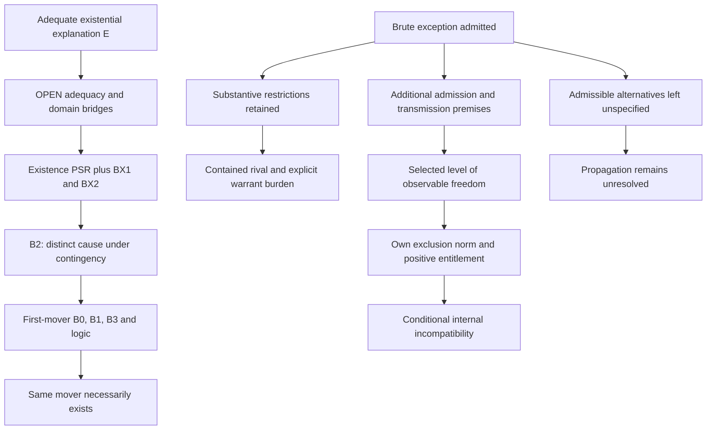
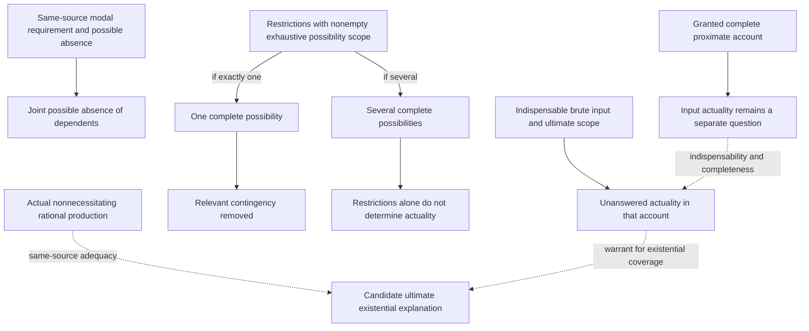
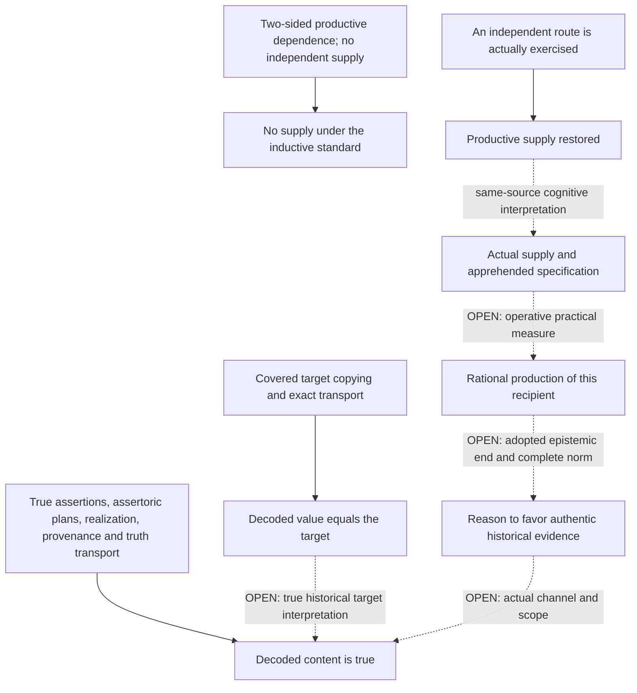

# No ultimate foundation, radical law-change, and whole-history stability

Current integrated assessment: [Actual exercise and evidence-channel bridges](#continuation-actual-exercise-and-evidence-channel-bridges).
The earlier [metaphysical containment checkpoint](#metaphysical-explosion-and-containment-2026-11-24) retains its own scope. [Original PR #1809](https://github.com/moritzbrantner/formal-logos/pull/1809)

The continuation [Existential inheritance under perfect containment](#existential-inheritance-under-perfect-containment-2026-11-24)
grants the stable rival's restrictions in full. Its question is what remains
unexplained after the threat of arbitrary further onsets has been contained.
It does not strengthen the original conditional into an explosion argument.

This is an **ontic conditional** for the God-existence-stage explanation question
in #735, extending the exact existing #736 history-selection, #737 predictive,
#743 law-actuality and #1801 persistence-law distinctions. It addresses a
particularly sharp opponent: **there is no ultimate explanation of the order,
and no deeper necessity or actual power constrains which local law governs at a
later time**. Whether the opponent is committed to that second clause, rather
than a merely brute **stable** law, is the decisive live question.

The mathematical result is not an unconditional refutation of naturalism or of
no-foundation views. It asks what a *radically unconstrained future* costs **if
admitted as an ontic range of complete alternative histories**. No extensional
trace model by itself makes these histories metaphysically possible, and no
theorem derives that admissibility from absence of an ultimate ground. The
inference `no ultimate ground → all future transitions admitted` is **OPEN**.

## Exact formal discriminator

`TruthCore/Explanation/NoFoundationLawChaos.lean` imports existing
`UltimateExplanation.Profile`, `Follows`, `Cell`, `openFuture`, `stable`, and
`LawActuality.UsesRecord`, as well as the existing `History`/`SameHistory`
signature. Its four properties have separate frozen Challenge declarations:
`Certificate`, `LawSwitch`, `OneRival`, and `Omissions`.

1. **Unrestricted suffix, not merely one unexpected event.** `splice n tail`
   leaves the exact observed `true` values through `n` and installs an
   **arbitrary whole infinite Boolean suffix** thereafter. `SuffixComplete p n`
   says every such complete path belongs to `Cell p on n`; the exact `Certificate`
   characterizes `Cell (openFuture n) on n` as *all and only* the paths with
   that prefix. Thus any prescribed collection of later flips, including
   infinitely many, is admitted. No external probability or temporal-causal
   relation is assumed.
2. **Populated, distinct whole histories.** `realized : History Trace Bool Nat`
   represents exactly one Boolean state at every time in every path-world,
   with `ExistsAt` agreeing at now=0. For **each** unobserved `k ≥ n+1`,
   two witnesses agree at *every* observed index, differ at `k`, and have
   different `SameHistory` presence extensions. Both are populated, rather
   than a degenerate empty-world control. They represent state values, **not**
   the persistence of one concrete substance with a fixed identity.
3. **Every predictor and every later time.** For any `predict : Trace → Bool`
   satisfying the *existing* `UsesRecord n` (all possible inputs with the same
   entire record receive the same prediction), and **any** `k ≥ n+1`, there
   is no exact prediction uniformly correct across an `SuffixComplete` class.
   This is stronger than #737's failure of its particular persistence
   `forecast`, though related to #743's all-estimator failure at first
   unobserved time for a pair of individually unique laws. It tests a
   **uniform zero-error requirement**, not fallible justified induction.
4. **Every complete-history law claim.** `UniversalProjection p q n` means the
   same candidate `Profile q` is satisfied by **every** path in the admitted
   cell, not simply by one actual path. If `SuffixComplete p n`, any such `q`
   must permit **all four** Boolean successor pairs at every `t ≥ n+1`.
   Therefore *every* candidate law excluding at least one late transition
   fails that universal projection, and **no deterministic candidate law**
   can pass it. The result quantifies over *all* time-dependent relations
   `q.step`, not just persistence, periodicity or a finite list of laws.

The strongest piece is the **iff**, not merely a failure witness. For every
candidate `q`, `UniversalProjection (openFuture n) q n` holds *exactly when*:

| Law component | Necessary and sufficient across all admitted paths |
| --- | --- |
| Initial condition | `q.initial = true` |
| Earlier transitions `t < n` | `q.step t true true` |
| Boundary transition `t = n` | Both `q.step n true true` and `q.step n true false` |
| All later transitions `t ≥ n+1` | `q.step t a b` for **every** `a,b : Bool` |

So a law may still describe the already fixed past, and a fully permissive law
may be universally true; no surviving universal law restricts later Boolean
changes in this explicitly radical model. This is a statement about truth
across the *selected alternative space*, not about whether a stable law can be
true of the *one actual history*. It does **not** show that non-deterministic,
stochastic, dispositional, probabilistic or law-of-law constraints are impossible
under weaker rival commitments.

### One fixed radical rival, with explicit switching rule schedules

An important quantifier control avoids adjusting the theory with the cutoff.
The original #737 profile `openFuture n` changes as `n` changes. `OneRival`
instead uses the **same fixed** profile `unconstrained` at *every* possible
finite cutoff. Its admitted complete paths are exactly the paths with initial
value `true`; for any record prefix, all suffixes are available. This is one
coherent, nonempty alternative *model class* with arbitrarily late deviations,
not a new model selected opportunistically after each observation.

`scheduled switches` gives a different, **individually deterministic**
transition profile for every Boolean law schedule:

- `switches t = false`: next state equals current state (*copy law*).
- `switches t = true`: next state is its Boolean opposite (*toggle law*).
- `generated switches` is its unique complete state path from initial `true`.
- `toggleFrom k` copies through step `k-1` and **switches the rule** to toggling
  at `k` and thereafter. For every `n ≤ k`, its generated trace agrees with
  the never-toggle trace through the whole observed prefix `0..n` but
  disagrees at `k+1`. The laws themselves prescribe opposed transitions
  at `k`; this is not just two outcomes under one unchanged deterministic law.

Moreover, for **every** path `f` with `f 0 = true`, `scheduleOf f` records the
complete path's adjacent changes, and `f` satisfies that schedule's unique
deterministic profile. Therefore one fixed unrestricted class equals the union
of all individually deterministic schedule solutions. It can admit every later
rule reversal without any one governing schedule determining all possible
histories. The extracted schedule is **ex post, dependent on the entire
explanandum**, and is not an independently given mechanism, explanation or
epistemically available prediction. This limit is essential to the argument.

## Crucial omitted assumptions and controls

`Omissions` retains four controls in the same Boolean/model language:

| Comparison | What actually follows |
| --- | --- |
| Stable `Profile`, populated `Cell stable on n on` | All admitted stable paths follow the same copy law. There is no `SuffixComplete stable n`. Scientific stability is logically compatible with leaving ultimate grounding unexplained. |
| One open class, the admitted stable path `on` | `on` is admitted and follows `stable`. Suffix freedom allows a stable *admissible continuation*, rather than asserting that all histories really become chaotic. |
| Unrestricted profile `unconstrained` | It itself projects universally, but forbids no future transition and is nondeterministic. Our result forbids substantive future-excluding *universal* projections, not every tautological/procedural law statement. |
| `impossible` false initial condition with `on` observed | Its cell is empty, so arbitrary law projections pass vacuously. The main discriminator has explicit populated alternatives and does not use this escape. |
| Existing scopes `brute` and `grounded` | `brute` has **no** totality ground but can be paired with `stable`; `grounded` **does** have a totality ground and can be paired with `openFuture`. Grounding status and admissible law alternatives are independent model coordinates until bridged. |

The last control directly refutes the proposed **bare logical inference**
`¬ GroundedTotality → SuffixComplete` in the unrestricted product class. It
does not prove that a real brute world has stable laws, that a grounded world
has open laws, or that `GroundedTotality` is full ultimate adequacy. In #737,
`GroundedTotality` only means some supplied ground of `spacetime`; it does
not mean a necessary self-explanatory God or an adequate reason for everything.

## Whole-history explanation and law actuality: two debts, not one

The radical rival must answer **the same explananda** as a grounded-law account:

1. **Which whole history obtains?** #736 shows that an invariant whole
   reason-vector cannot be transformed by arbitrary information-only operations
   into an entailing selector when accessible different presence histories share
   that vector. #743 adds individually unique deterministic laws with identical
   finite observations and represented populations, without showing why the
   actual law rather than its rival obtains. A Humean best-system description
   can be *true of* the full selected mosaic while the question *why that mosaic
   is actual* remains open. The standard here is **entailing selection**,
   not a theorem that all adequate explanation must entail its effect.
2. **What fixes the laws' continuing operation?** Under the radical thesis,
   no constraint on later law schedules is supplied; every future copy/toggle
   pattern can be a distinct, individually deterministic complete history.
   The universal law projections that would prohibit some transition fail by
   the theorem. Observed regularity alone does not supply a stable cross-time
   restriction. To make robust global forecasts the opponent owes a warranted
   genuine restriction on admissible law schedules, a qualified propensity or
   exception structure, a necessary/dispositional nature, an actual mechanism,
   or a frankly limited methodological rule. Simply labeling the observed
   schedule a law *after the fact* does not select or constrain it.

These debts combine **only under the strong radical premise**. The proof does
not identify lack of ultimate explanation with unrestricted admissibility;
a restriction on law schedules is an additional substantive metaphysical
commitment whose actuality and warrant remain to be explained. The stable
model control and the existing comparisons in #737/#743 preserve this boundary.

At #1801, the dispute about existential inertia is even more specific:
a law plus **earlier existence** may explain a *later state or continuation*
without thereby offering a ground of the complete law/actuality conjunction.
If the law-fact is grounded by precisely the whole-history fact it purports to
ultimately ground, using that same grounding relation in both directions
conflicts **conditionally** with its independently defended asymmetry. Neither
whole-history law-supervenience nor grounding asymmetry, nor an actual present
productive sustaining requirement, is supplied by this module. A law of
*state* does not automatically govern the continuing *existence of the same
received-esse bearer*. The #1801 same-bearer and explanatory-status bridges
to `40a97664` remain **OPEN**, not silently settled by Bool state tokens.

## Provisional comparison and exact open bridges

The [population, power and evidence tests](#can-a-brute-founder-be-joined-by-another-cause) give the current assessment of the upstream inference.

As of the baseline `4aab093cc06bc1924bdf8067bd5780e11f438770`, the
strong radical rival has a genuine **conditional disadvantage** for global
law stability: it cannot simultaneously grant unrestricted future admissibility
and claim one all-history deterministic/future-excluding transition law, or
a record-only uniformly correct later forecast. This follows from a precise
model-theoretic contradiction, not an appeal to the psychological unpleasantness
of chaos. Its rational reply may reject the universal guarantee criterion,
restrict its metaphysical alternative set, defend a brute stable law or adopt
qualified empirically successful but fallible inference. Those are distinct
positions and must be reassessed under their own commitments.

It remains an **OPEN philosophical bridge** to infer from mere lack of a
necessary foundation that all possible future transitions or every law schedule
are ontically available. It is a further **OPEN bridge** that a real adequate
ultimate explanation must select this law/history in the strict #736 sense.
Theist accounts also owe a substantive account of how their proposed ultimate
ground sustains the particular governing structure and makes actual law use
and epistemic access possible. An unexplained choice by a necessary being
does not become an explained law schedule just by being attributed to God.

The most discriminating next test is therefore a defended **modal/causal
restriction principle about change in laws**, paired with a counterfactual
model at the same ontology and observed history. Does the radical rival
actually affirm arbitrary future law schedules, or only absence of ultimate
reason? What independently warrants the selected restrictions on whichever
side asserts them? If a law is said to ground whole-history actuality, test
the same fact/ground direction rather than transferring the result from a
mere law of state succession.

## Provenance, challenge and verification boundary

- Exact reuse: `TruthCore.Epistemology.UltimateExplanation.Profile/Follows/Cell/Deterministic/openFuture/stable/on`, `TruthCore.Explanation.LawActuality.UsesRecord`, `TruthCore.Modern.Hume.Regularity.GroundedTotality/brute/grounded`, and `TemporalHistory.History/CoherentAtNow` plus `HistoryContrastive.SameHistory`. No new logic, agent, evidence authority, grounding ontology or source claim.
- Prior #737/the pinned Hume *Enquiry* IV/V material compares finite past
  observations to future continuation; #736/#743 notes pin the global
  explanation and law actuality comparisons. Leibniz *Monadology* §§32,
  36–38 is the inherited PSR contrast; no new exact historical quotation or
  source attribution is asserted here. Source fidelity and the rival's
  metaphysical applicability must be judged separately.
- Frozen new Challenge:
  `TruthCore/Results/Explanation/NoFoundationLawChaos/Challenge.lean`, SHA256
  `c6b58fafc294479ea27516f8661d97532b2ae32240ffbc4339c4345bcabbcbed`.
  The `Solution.lean` proof is an independent draft consuming this unchanged
  Challenge interface.
- **Verification status:** no Lean/lake and no prepared `truth` CLI are present
  in this local research clone. Kernel, theorem binding, Comparator and NanoDa
  checks, the exact-head build and independent final-outcome review remain
  required. Neither this written proof draft nor its theorem names should be
  called mechanically certified until those checks pass.
- **Root impact:** four new analyst statements, premise-free conditional
  arguments, inference records, result records and Comparator configurations
  were generated from `specs/no-foundation-law-chaos.toml`. Existing root
  routes, premise statuses, closure flags and source claims were not changed.
  Expected root-frontier impact: **none**; exact `frontier-diff` remains pending
  the coordinator's CLI/CI. The live connection is an explicitly proposed
  bridge to the ultimate-ground and persistence explanatory comparison, not
  an already established root entailment.


## Upstream recombination/closure checkpoint — 2026-11-23 (#1867)

This section extends the earlier suffix-complete downstream results, without
re-proving their forecast, law-projection or strict-norm consequences. The new
certificate is `NoFoundationLawChaos.RecombinationFork` and its result record
`765d8679-3405-4276-be0f-f71b8248b863`. Its scope is a fixed set
`allowed : Trace → Prop` of **complete** Boolean histories, intersected with
the same `Cell (openFuture n) on n` observed through `n`. The selector is
not itself a grounded law, an explanation or metaphysical accessibility.

### Argument graph and exact assumptions

```text
U: no sufficient ultimate why-this-total-order explanation
  X→ N: no essential/governing/modal transition constraints       [OPEN]
  X→ R: local temporal recombination (same history selector)     [OPEN]
  X→ C: prefix closure of the admitted infinite-history class   [OPEN]

Population + R (OneStepRich) ──[Lean conditional]──> F (FiniteRich)
F + C (PrefixClosed)        ──[Lean conditional]──> S (WholeSuffixRich)
S ──[Lean-only adapters, unregistered; then existing #1809]──> D1:
  no record-only exact forecast at a later index, no deterministic or
  future-excluding Profile holding on every admitted history
S at every cutoff, one fixed selector
  ──[Lean-only adapter, unregistered; then existing #1808]──> D2:
  an additional stance's OWN strict guarantee norm + positive
  entitlement leads to its internal contradiction

Whole-order explanation (#736/#735), ontology of law (#743), epistemic
norms (#932/#737) and the God-existence stage (#143):
  U-vs-necessary-ground comparisons remain relevant;
  U→R, U→C, ontic actuality, access and same-source production are OPEN.
```

Here **R** is precisely the `OneStepRich` *complete-history*
extension property: given an already allowed history and a cutoff after the
observed record, choose either next bit while keeping the previous finite
segment; the resulting history must again be allowed by **the same selector**.
This is not merely permission to describe a local patch independently of
global boundary conditions. **F** allows a *different complete extension for
each finite cutoff*. **C** asserts that one particular infinite candidate
whose every finite prefix is individually extendable is itself allowed.
C is not implied by recursively repeating R; the witnesses for each cutoff
may be different. With a populated cell, R gives F by ordinary finite
induction. F+C then gives S by applying C to each spliced target history. No
ontic absence-of-foundation premise occurs in either Lean implication.

Mathematically, the F+C→S step is the standard Cantor-space fact that a
closed set dense in a cylinder contains the whole cylinder, and the
eventually-constant countermodel is the standard dense-but-not-closed set.
The progress here is the application, the exact separation of R, F, C and
population as distinct premises of the law-chaos inference, not new
mathematics.

**Adapters to the downstream certificates.** S is stated over a global
selector (`WholeSuffixRich allowed n`), whereas #1809's `certificate` takes
`SuffixComplete p n` and `UniversalProjection p q n` over a Profile cell, and
#1808's `internalDiscipline` takes `BothSuccessors s` over `Stance.admits`.
`TruthCore/Results/Explanation/NoFoundationLawChaos/Adapters.lean` bridges
both formally. `wholeSuffix_profile` shows that a Profile `q` holding on every
selector-admitted history is suffix-complete and universally projected on its
own cell, so `wholeSuffix_future_total`, `wholeSuffix_no_deterministic` and
`wholeSuffix_no_forecast` are #1809's conclusions for the selector.
`selector_bothSuccessors` shows that one fixed selector with S at **every**
cutoff gives `BothSuccessors` for the stance admitting exactly the
selector-admitted histories (using `splice n (fun _ => true) = on` and
`splice n (delayedFailure (n+1)) = delayedFailure (n+1)`), and
`selector_internalDiscipline` composes it with #1808. These are Lean-only
lemmas, not registered corpus results, and they connect only the formal
hand-off: whether any real law space satisfies S is the OPEN applicability
question above.

### Three contrasting populated selectors

| Fixed complete-history selector (all share the observed prefix) | R / F | C | S | What this establishes |
| --- | --- | --- | --- | --- |
| `finiteSwitchClass` = eventually constant (finitely many switches) | yes / yes | no | no | At every finite cutoff the proposed pattern can be realized and then stabilized; the single infinite alternating trace is excluded. A stage-rich nonempty rival does **not** admit all infinite outcome traces (and their ex-post `scheduleOf` codings). |
| `stableOnlyClass` = just the always-true history | no / no | yes | no | A positive stable history with strict law restriction can be closed. Closure alone does not create choices. The separate `Omissions` certificate already permits this alongside `¬ GroundedTotality brute`. |
| `allHistoryClass` = every Boolean trace | yes / yes | yes | yes | A coherent fully unrestricted comparator; the downstream chaos certificate applies only once this strong selection is warranted. |

`emptyHistoryClass` satisfies R and C vacuously, but fails S, so actual
**population** is an additional necessary hypothesis for deriving F from R.
It is not a candidate view of our populated world. These selectors are
structural mathematical controls, not independently certified metaphysically
possible universes. The alternating trace is a complete, countably infinite
path; it differs from every eventually constant path at arbitrarily late
times. A single finite switch, a finite but unbounded number of switches, and
an infinite sequence of switches must not be conflated.

### Positive grounds and limits of the disputed transitions

**Why might R hold?** A Humean recombination advocate can argue that local
successor configurations have independent modal standing and that there are
no cross-time constraints beyond the preserved past. This can make the
one-step substitution plausible, especially for explicitly stipulated
independent Boolean states. However, independence of intrinsic local qualities
is *not yet* independence of entire governing law schedules. A single
time-independent law, conservation invariant, global boundary value,
dispositional essence or dependence relation can forbid the replacement
even if the altered finite state-description is logically consistent.
To apply R, the advocate must show that every chosen next outcome has an
admissible **complete** continuation under the actual intended modality
and retained background, rather than stipulate the conclusion.

**Why might C hold?** If every admissibility exclusion has a *finite local
witness*, then the complete-history class is closed under agreement on all
finite prefixes: any excluded candidate has a finite prefix that excludes all
its completions. For one fixed ordinary `Profile` with initial value and
time-indexed pointwise transition constraints, a failure of `Follows` occurs
either at time zero or at one finite successor pair. Thus its class of
satisfying complete paths has this *mathematical* closure property
(`Adapters.follows_prefixClosed : ∀ q n, PrefixClosed (Follows q) n`, a
Lean-only lemma, not a registered result). This is a
positive structural rationale for C when **all** admissibility constraints
really are of that form. It does not establish that ontic/metaphysical
admissibility is exhausted by those local law equations.

Conversely `EventuallyConstant` is an explicit *global tail requirement*:
no fixed finite prefix identifies failure, because it can always be completed
by a constant tail. It is a coherent extension policy with F but without C.
This matters because metaphysical possibility may be sensitive to global
histories, persistence, infinite actualization requirements or other
non-finitely-witnessed restrictions, rather than only local safety constraints.
First-order logical compactness or arbitrary mathematical limit-taking does
not by itself prove the ontological admissibility of the **specific** limiting
trace. A further modal closure or finite-witness account of all exclusions
is the live philosophical premise. The model does **not** prove that
eventually-constant global constraints are actually fundamental.

**Law schedules versus state outcomes.** The old `LawSwitch` establishes
that every Boolean history with the specified initial state has an *ex-post*
deterministic copy/toggle schedule. That mathematical coding does not show
that distinct schedules are independently physically available or can change
the *fundamental* governing structure. To derive actual law arbitrariness,
R/F/C must apply to a justified domain of law configurations with fixed
bearers, dispositions, consistency conditions and time horizon—not merely
to output bits. That application bridge remains OPEN.

### Explanatory and epistemic alternatives at matching scope

| Proposed stopping/explanation | Continued actual stability | Alternative histories / modal restrictions | Remaining why-question and epistemic test |
| --- | --- | --- | --- |
| Brute cosmic order | Its actual long-lived regularity can be taken primitive; no inconsistency follows. | The selector may be stable, finite-switching or otherwise restricted; no particular modal space follows from primitiveness alone. | Why this exact mosaic and its stability, rather than another? Successful induction may be defeasible and empirically warranted even if the whole-order why-question is left brute. |
| Humean best system | Summarizes, predicts and unifies the actual mosaic by a comparatively simple informative system. | Best-system lawhood is not automatically a governing restriction on *metaphysically possible* alternative mosaics; the chosen recombination principle must be supplied. | Explains pattern-under-description and practical theory choice; whether it adequately explains *why this mosaic obtains* is the exact #735 contrast. |
| Primitive governing law | Actual law may be a real modal constraint ruling out contrary transitions even without an explanation of its own actuality. | A fixed transition principle provides a genuine admissibility restriction. | Its instantiation, persistence, exceptions and epistemic detection require separate assessment; the primitive itself is an allowed stopping point. |
| Dispositional/essential powers | Stable effects follow from the powers that concrete subjects possess. | Intrinsic identities and powers constrain which successors are coherent, potentially rebutting R at a definite local step. | The actuality and distribution of those powers and the composition of the whole order may remain open; test concrete causal conditions rather than an opaque label. |
| Necessary impersonal ground | A necessary structure might constrain law space. | Necessity of the bearer alone does not select the actual contingent law unless the same relation is shown to do so. | Needs actual productive/grounding efficacy, explanatory adequacy and empirical access; a necessarily existing idle structure is no sufficient account. |
| Classical-theistic source | A necessary intelligent source may provide a unified reason for the order and its continued applicability. | Sourcehood does **not** by itself show why this particular world/law is selected or exclude unexplained contingency in the source's choice. | Same source, actual causal activity, sufficient contrastive reason, law persistence and intelligibility to finite inquirers are separate OPEN burdens (#735/#737 and intellect/will routes). |

The **provisional assessment** for the stated #1867 target is that the
unqualified inference **U → S is not supported**. The already certified
brute-stable control (`Omissions`) shows only that the bridge-free inference
fails in this formalization: U-style ungrounded totality and a stable law
coexist in the product model. It does not show that a substantive U→R or
U→C bridge is false. R has a substantive
recombination rationale **only** for modalities satisfying genuine
cross-time/local independence; C gains conditional rationale from
finitely-witnessed exclusions, but does not follow from F. C and U are
independent by construction in the product model; no theorem relates U to
selectors, so "C does not follow from U" is a fact about the model's shape,
not a separate theorem.
U alone is consistent in this formalization (`Omissions`). Whether naturalism or U undermines epistemic entitlement
(EAAN, e519065f) remains OPEN and is not assessed here. Under S,
all-continuation **certainty**
fails; under S plus a rival's *own* strict certainty norm plus positive
entitlement there is an internal conflict (#1808, through the Lean-only
adapter above). Scientific induction,
probabilistic calibration, explanation conditional on laws and robust
practical decisions remain possible without deductive guarantees; what
warrants their real-world reliability must be evaluated separately (#737,
#932, #1734). A bare U claim is not formally self-contradictory.

**Next test (reopening condition):** obtain a concrete, independently
defended ontology of laws and metaphysical recombination that both permits
unrestricted successor substitution and shows *all* relevant global
admissibility exclusions are finitely witnessed. Run the identical-history
test on an actual law-configurations domain, not just on state traces. If
that package survives, instantiate S and only then compose the existing
#1809/#1808 epistemic consequences through the adapters. Alternatively,
identify a specific
necessary or dispositional restriction that independently refutes R at the
same fixed history and law identity; compare its explanatory actuality
with the brute stable and necessary-ground options. The #735/#737
God-existence-stage link is **comparative**; no new root route, premise
discharge, anti-atheism theorem or stronger interpretation is claimed.

**Connection plan (OPEN, not an existing route).** #735's whole-order
explanation target is `STMT-LEIBNIZ-SERIES-SUFFICIENT-REASON` (702e4171),
which does not itself reach the root. The nearest root-route node whose
rival this work prices is the local existence PSR for contingents,
"Every being contingent at w has some reason for its existence" (608a262d,
bare), which reaches `STMT-CATHOLICISM-TRUE` through B2 (a8823bd2), the
First Way necessity step and the quarta via route (fa24c576). Its rival is
brute contingent existence. The missing bridges are (1) a sense-checked
bridge identifying the denial of 608a262d (no #312 reason token for some
contingent being's existence fact at w) with U here (no `GroundedTotality`
of the supplied #737 scope for the whole order of transitions): the
explananda and the relations differ; and (2) the U→R and U→C applicability
bridges above. Even with both, the result would bear only on the comparative
cost of the brute-contingency rival, not derive 608a262d, and D2 binds only a
rival that endorses the strict norm. Blocker: no independently defended
ontology of law recombination instantiates R and C, and no reason-token to
grounded-totality bridge has been formalized.

**Verification and review tracking:** The new theorem's Challenge, Solution,
spec, result/comparator record and this note are proposed on PR #1874 for
#1867. An independent semantic challenge of that PR (repair pass 1) found
one unbuilt connection drawn as existing (now built as Lean-only adapters),
one unsupported universal non-entailment claim about naturalism (replaced),
and several wording and scope overstatements (corrected). Mechanical Lean,
binding, Comparator, NanoDa and the computed frontier-diff are evaluated on
the exact PR head in CI.


## Causal propagation of a brute contingency (2026-11-23, #1867)

Three registered controls fix what changes between the compared alternatives:
the admitted population, the available interventions and the measurement
offset. Each passed Lean, binding, Comparator and NanoDa. Their application
to real modal possibility is assessed below.

The question is whether admitting one brute existent licenses an additional
uncaused agent *in an already populated order*. A restriction can be principled
if it specifies a property that can independently be identified and that would
exclude the proposed addition. A separate question is why that restriction
obtains and how far its necessity extends. The comparison below continues
#1874's results on admissible histories, #1908's regress comparison and
#1910's self-application test.

### Three different propagation theses

Fix actual world w, the same rigid concrete candidate b, an accessible
absence alternative v, and a specified family of actual positive empirical
facts Q. Grant for this investigation that b exists contingently and has
no adequate actual existential reason. That is stronger than the mere
absence of a selected causal predecessor. The formal token-level
`b36104ba` rival is related but not an adequacy certificate.

1. **Ultimate explanatory dependence.** If an adequate *complete*
   explanatory account of a fact q must account for the actuality of b
   (not merely cite b or give a conditional mechanism), and b lacks an
   adequate actual reason, no such complete account of q succeeds.
   Proof: a purported successful account would, by the explicitly stated
   completion condition, supply an adequate reason for b, contrary to
   the premise. This is relative to the complete-account standard; no
   new theorem says every explanation must meet it. A real causal
   dependence can justify including b in a complete account, but graph
   ancestry or mere material implication does not certify explanatory
   inclusion. The local mechanism can explain q and thus q is not
   necessarily brute. The missing reason is upstream.
2. **Modal transmission.** Suppose for each q in Q, q actually obtains
   and q's obtaining in any accessible history requires the existence
   of b in that history (not necessarily at the same time if q is an
   effect of an originating act). With the admitted b-free alternative v,
   each q fails in v. Hence each q is contingent at w on the chosen
   scope, with one common absence witness. For existential facts this
   is the strong selected dependency reading of
   `STMT-DEPENDENCE-EXCLUDES-BEING-WITHOUT` (000e1f65), not mere
   causal ancestry. Event/state facts require their own interpretation
   bridge. For a sustaining source, retention of the bearer and the
   relevant concurrent receipt must be established; for an originator,
   its existence somewhere in the relevant complete history is the
   issue. This does not establish unrestricted independent variation
   of the q's or the failure of empirical knowledge; v might have no
   observers at all.
3. **Arbitrary selection of empirical values.** Fix the background
   laws and retained conditions, a nonempty set of admitted possible
   source configurations U, and an observation map F into the
   outcomes for the specified empirical facts. Here U is a mathematical
   parameter, not the earlier section's abbreviation U for no ultimate
   explanation. To make terminology unambiguous below write S for
   the source-configuration set. Individual variability means that
   each selected Boolean output coordinate takes both values on F(S).
   Joint arbitrariness means that F(S) contains every proposed joint
   assignment in the selected output domain. Neither follows from
   explanatory incompleteness; individual variability is strictly
   weaker than joint arbitrariness. A complete deterministic map can
   still satisfy the latter if the source has enough admitted
   configurations and the map realizes their distinctions.

The first conclusion is a sense in which a brute root's explanatory
deficit can propagate to an entire order **even if every physical law
and every local mechanism is stable**. It is not the claim that all
facts become ontologically uncaused. The second gives shared contingency,
not arbitrary laws. The third is closest to the requested explosion,
but requires an explicit modal and causal amplification premise.

### Why connectedness is insufficient, and what is sufficient

Reuse #1399 / merged #1406
([causal transitivity](causal-transitivity-1399.md), result
1ab3858a-b0cb-4475-b22d-b397858a76a2). In the actual Boolean
intervention model X=Y=Z=1, Y=X and Z=(X==Y), intervention X=0
changes Y, intervention Y=0 changes Z with X held actual, yet
intervention X=0 leaves Z true after recomputation. The registered
result also proves the pure binary chain conditional and the
compensating-direct-effect boundary. Do not read transitive closure
as actual difference-making or existence-giving. Even complete
causal connectivity in a selected graph is not a certificate of
universal influence. Conversely, a positive account of productive
contribution may retain causal ancestry despite endpoint cancellation;
that is not enough to show the endpoint could be different.

A second discriminator isolates the quantifiers. One free Boolean
input b with a deterministic copying mechanism gives n outputs
(b,b,...,b). Each coordinate can differ from its actual value, but
there are exactly two joint vectors, not 2^n when n>1. The input
could stand for the presence of a stipulated trigger in an admitted
alternative; that requires an interpretation of real existence not
given by the bit. Neither the copying law nor the many outputs
creates new independently selectable information. In general a
deterministic map from m allowed configurations has at most m
distinct joint output vectors. A single presence/absence choice
with everything else fixed cannot generate unrestricted assignments
of even two binary facts. It can, however, affect every output
at once in an appropriate model. This makes the owner's common-mode
intuition precise without claiming classical explosion.

### Stronger mechanism: stable laws, unrestricted empirical histories

The #1874 investigation derived suffix richness from one-step
recombination and prefix closure on **output traces**. Here consider
an alternative *causal implementation* of suffix richness with
the same fixed transition at every time, rather than a changing
law schedule or an unconstrained transition. It is a mathematical
surrogate for causal powers, not a model of concrete existential
actualization.

Let the initial state be a Boolean tape a : Nat → Bool. At each
step the one fixed deterministic transition shifts the tape one
place, L(a)(i)=a(i+1), and the observer reads O(a)=a(0).
After t shifts, O(L^t(a))=a(t), by induction on t (the stronger
identity L^t(a)(i)=a(i+t) is preserved by one shift).
Let the admitted initial tapes be a fixed class I. Then the set of
complete observed traces is exactly I: the forward inclusion is
the readout identity, and every a in I realizes itself as the
observed trace. Hence:

* If I admits every tape with the actual recorded prefix, every
  future observed suffix is admitted, despite the single fixed,
  deterministic microstate transition L.
* The same holds if I has the #1874 one-step richness, nonempty
  prefix cell and prefix closure, applied to initial tape values.
  The previously certified consequence supplies complete suffix
  richness of the tape class; the readout identity transfers it to
  the observed trace selector. This is a proposed mathematical
  application of the existing result, not a built Lean adapter.
* If I contains only the two constant tapes, the observed cell
  after the first read has a unique trace. If it consists exactly of the
  eventually constant tapes, all finite extensions are admitted
  but not arbitrary infinite traces. The *same* mechanism and
  observation map are retained. The decisive difference is what
  source states are admitted and how they propagate, not the name
  "deterministic".

The law L is deterministic on full tapes, not on the observed
single bit. #1809's all-suffix result can therefore defeat
restrictive universal **observed-bit transition** profiles without
contradicting determinism of the full state law. To use the existing
Profile-cell adapters the observed profile must admit the selected
traces; the full tape law is not itself a Boolean Profile. For
physical interpretation, a source containing arbitrarily selectable
information and a mechanism releasing it would suffice to make
arbitrary late outcomes compatible with stable local equations.
The unrestricted initial-state assumption is substantial. A
single brute concrete being need not have an infinite tape's
information capacity or even two independently variable powers.
Nor does absence of an explanation of its existence make every
initial tape admissible. The construction shows a pathway from
unrestricted source configurations to observed chaos that does
not need fundamental law switching; it does not establish the
required modal or physical application.

A finite check (Python enumeration, 8-bit tape with zero-fill
shift, first eight reads) found 256 distinct traces and 32
continuations after prefix 111. Copying one shared bit into eight
positions gives exactly two vectors with both possible values in
each coordinate. These are exact checks of finite controls only;
the infinite readout identity is the elementary induction above,
not a Lean-certified result in this checkpoint.

### Can a brute founder be joined by another cause?

Fix a nonempty class of histories retaining a specified past and background
K, including the original founder where required. Describe a requested
entrant by its kind, site, onset, power and target independently of whether
it can obtain *jointly* with K. Count a request as individually eligible
when its onset and exercise are possible under the same laws with the
retained occupant requirement relaxed. The solitary late agent in the
capacity-one model supplies precisely that witness. **Insertion freedom** says
that for every such eligible request there is an accessible complete
continuation retaining K in which an additional unreceived bearer actually
obtains and exercises that power. The negation at this background is one
eligible request for which no such continuation exists. The negation of
“whenever there is a brute founder, there is insertion freedom” requires
both a brute founder and a failed request. The separate thesis that *no*
intruders are possible falls to a single admitted intruder. A joint licence
requires all members of each eligible list in the **same** continuation.
Its denial can coexist with every singleton request being granted.

“Only foundations can be brute” has two readings. If a foundation is anything
whose existence has no prior giver, a wholly new unreceived agent qualifies
even if it arrives tomorrow in a crowded laboratory. If a foundation is the
antecedently specified total basis of this order, excluding such an agent
requires showing that the basis is exhaustive. One can establish a
restriction on a particular class of candidates by showing how membership
requires a giver. The dispute concerns its coverage, including kinds absent
from the actual inventory. A claim about what existing powers do when
instantiated addresses only part of that question.

**Test with the actual founder held fixed.** In all three interpretations
the same individual exists in the designated history, is absent in an
accessible alternative, has no incoming cause and lacks any #312 reason
for its existence at the selected world and time. It causes a distinct
firing for which the model supplies a circumstantial reason. Thus each
interpretation satisfies the literal negation of the contingent-existence
PSR `608a262d` there, and its assigned explanations are sound in #312's
sense. No premise identifies every uncaused thing with a thing lacking a
reason. The detector mechanism is identical in all three cases. Each new agent
persists and produces one firing one tick after birth. The detector
registers a firing without identifying its source. [Population definitions and comparison](../../TruthCore/Explanation/PopulationEntry.lean)

| Admitted populations | What can happen with this founder retained? | What fixes the answer? |
|---|---|---|
| The number of extant agents is conserved at each step. | The initial population and persistence exclude every later birth. | Each birth increases the cardinality of the actual finite set of extant agents. |
| At most one agent is present at each time. | No late entrant can join this founder. In its absence the same candidate can begin at the proposed date. | A continuing occupant uses the single place. A law imposing this ceiling need never refer to the founder's name. |
| Birth inputs are unrestricted. | For each later date a complete history adds one uncaused, unexplained agent and changes the same detector reading. | All other birth inputs and every entity's presence through the preceding tick agree. Positive input admission and an effective coupling do the work. |

Capacity one defeats the inference from a brute founder to universal
admission of individually eligible requests. Conservation excludes even a
solitary late onset, so the set of such eligible requests is empty in that
model. It defeats the separate claim that some later unreceived onset must
be possible at all. Unrestricted birth inputs witness an effective insertion
and defeat a universal ban. Interpreting these histories as metaphysically
accessible is a further claim.
The cause relation ranges over the selected order. The founder
has no incoming edge there, and an independently assigned valuation gives
it no existence-reason token. Neither condition establishes simplicity,
unlimited esse, or foundational status with respect to everything real.
The count ranges over the represented persistent agents. If a bearer can
leave when its successor arrives, constant headcount can mask replacement.
In #1867's unique-supplier example, a copy-power bearer and a toggle-power
bearer can succeed one another while the dependent persists and each source
keeps its characteristic power. Holding the same supplier throughout,
allowing one switch, or assigning both bearers the same power gives different
predictions. Even universal succession would require an account of the
particular rigid bearer's absence and of the dependent's continuing identity.
In the finite control from the #1867 handoff, retain the
initial copy bearer for the first transition. For the remaining three
transitions a stable bearer gives one power-code suffix (000). Allowing at
most one replacement by the toggle bearer gives four (000, 001, 011, 111).
Allowing all itineraries gives eight. Equal powers restore the single suffix
even when both bearers are available. These counts concern effective
copy/toggle codes in a structural example. They give no warrant for repeated
instantiation of a rigid bearer. The repository’s `GivesAt` places the
moment on the effect side and leaves the tenseless esse-cause relation
separate. One cannot infer the root’s beginning, temporal presence or
absence from that field alone. This applies #1908’s distinction between
transmitting and explaining a pattern to successive suppliers. A reason for a role always being filled can leave open who fills
it. [Regress and the same individual](contingency-receptivity-c2.md#what-does-possible-absence-have-in-common-with-an-infinite-regress)

### How a restriction can earn its scope

Consider two disjoint capture wells sharing one carrier. Routing the carrier
left or right may be a genuine alternative after the same past under a
branching routing power. The two simultaneous captures cannot both occur if
each requires possession of that carrier. One way to warrant the restriction
is to calibrate the transfers independently. Each permitted transfer debits
the sending location and credits the receiving location by the same amount.
Adding all transfers cancels internal contributions. Calibrated closed ports
and independently measured stock then support a definite prediction. A
spoofed display, sequential visits by the carrier, neutral entrants and a
balanced pair of new opposite charges are different tests. They need not
violate conservation of a measured net quantity. The premise that the ports
exhaust all ways of changing this target is empirically vulnerable. To make
it cover every metaphysically possible cause requires that the inventory be
essential and exhaustive at that scope. [Resource-budget derivation and its scope](productive-store-1378.md)

A concrete physical comparison isolates the work done by the inventory. In
Dürr, Goldstein, Tumulka and Zanghì's Bell-type particle theories the free
process preserves the realized particle number in its sector. Their example
with an external electromagnetic field admits pair creation and annihilation
under specified dynamics. Consider the analyst's extra hypothesis that the
initial configuration is brute. It leaves intact the first theory's exclusion
of an unmatched extra particle and the second theory's restrictions on
which changes can occur. To explain a detector change by an agent outside
either theory one must also give it a coupling to the detector. A model's
choice of configuration space alone is evidence about what that model can
represent. The metaphysical claim that its ontology exhausts reality needs
additional warrant. Neither existential bruteness nor that claim of
exhaustiveness is attributed to the authors. [Bell-Type Quantum Field Theories, §§2.8–2.9 and 3.3](https://arxiv.org/html/quant-ph/0407116)

### The strongest case for wider propagation

Start with independent grounds for the *possibility of an unreceived onset*.
An uncaused actual foundation that never begins supplies no such example.
Suppose now that a transformation preserves the entire retained background
and the modal laws, and takes an allowed onset at one site to a second
site. This warrants **relocating** the onset. It need not retain the first
agent. The two wells explain how perfect symmetry can coexist with a strict
limit on simultaneous occupants. Producing a duplicate also requires its
unreceived origin and powers to be admissible there. Experimental success
in moving a supplied trigger between apparatuses establishes something about
its efficacy in those circumstances. It leaves its existential origin open.

A stronger positive argument uses the successful composition of separated
preparations. When two interventions have matched boundary conditions,
independent supplies, no shared exclusion and a joint complete solution,
their local effects can sometimes be combined. For a finite chosen list of
targets, suppose that after any already permitted choices one can realize
either setting of the next target, with the earlier settings preserved,
through real sources and transmitting mechanisms. Induction on the list
then gives every joint output. Modularity, separately verified supplies and
observed resistance to cancellation provide defeasible reasons for this
premise in particular mechanisms. They do not cover the spontaneous
existence of their supplies. A rigid complete past can include a prior decree,
resource assignment or hidden input which the observable past omits.

The exact weakest *outcome* condition is that the realized output map covers
the specified target set. That condition restates joint coverage. No single
mechanism is necessary for it. One programmable common input could suffice.
The finite extension argument identifies sufficient conditions one can test
without already assuming every joint outcome. For infinitely many choices,
#1874 shows why extension to all finite lengths still leaves open whether the
limiting complete history is admitted. There is likewise no inconsistency in
a deterministic apparatus producing different outputs from different complete
inputs while its law and observed past agree. Fixing its complete determining
state as well removes that source of variation.

A connected three-site example makes the distinction experimentally legible.
An intervention flips both ends of either edge of a path. Every site can
change and any two target bits can be assigned as desired. Yet every sequence
preserves the parity of the three bits together. From 000 one can produce
110, 011 and 101, but never 111. An independently licensed intervention that
also flips one endpoint on its own changes the answer: the paired flips
reach every state of a given parity and the extra flip moves between the
two classes. This reuses #1088's parity coordinates and identifies the actual
operations that preserve or break the invariant. When auditing a proposed
intruder, asking **which conserved quantity can this agent change, by what
coupling, and while retaining which other conditions?** is stronger than
counting how many targets it can reach. Independent choice of paired
interventions already holds in this example. The missing operation is a
physically different intervention. [Reachable states and their proof](../../TruthCore/Results/Explanation/PairedInterventions/Solution.lean)

**A restriction on the recipient can suffice.** Give a proponent of brute
entry as many extra agents as desired. If every action on this still-intact
three-site target must go through its two paired inputs, any finite episode
of their actions still preserves its parity. The agents may differ in
number, origin, intentions and upstream powers. An exhaustive account of the ways **this target can receive an influence**
suffices for this exclusion. An independent proof that every interaction
preserves parity could establish it even with additional ports or an open
inventory of sources.
The proponent of propagation can challenge this at a precise point by giving
one agent an unmatched coupling that acts on the same target. Destroying the
device, replacing it, or falsifying its display can each affect an observer.
Each concerns a different outcome from changing its internal parity while
it persists. Port calibration and the design of a real instrument warrant
limited physical conclusions here. To extend the argument to *every possible*
way of acting on the same bearer, the restricted repertoire must belong to
its nature or follow from a genuinely exhaustive governing principle. Giving
a model only two inputs cannot settle that philosophical premise.

This also yields a test of the inference in reverse. Even decisive evidence
of a parity change would challenge the adequacy of the two-input account
for an intact, correctly read target. A new unreceived agent and a previously
unrecognized power of an existing agent could exercise the very same
unmatched coupling. Holding its effective operation and the readout fixed
gives the same observed result in either account. Evidence of the added
coupling by itself supplies no test of its operator’s existential origin.

### What survives interference with evidence?

Suppose that at two times true bits are p₀,p₁ and displayed readings are
rᵢ = pᵢ XOR bᵢ. A shared unidentified offset can reverse every *absolute*
reading, including copies stored in memory. Opposite truths can then yield
identical records. Yet the observed change r₀ XOR r₁ differs from the true
change p₀ XOR p₁ exactly when the offset drifts (b₀ differs from b₁).
For stable offset the change is recovered exactly from the two readings
even without knowing either absolute truth. Independent calibration of the
offset would recover the absolute reading too. Under unrestricted drift,
every displayed pair is compatible with opposite true-change answers.
The offset criterion is the registered Boolean identity `offsetAccuracy`. For any probability measure
on those assignments and an accurate comparator, the error probability
for the change equals the probability of drift. Counting possible errors
supplies no value for that probability.

This applies to an inquirer's observation, memory and reasoning only to the
extent that the relevant causal channels are reached. A corrupted stored
reading can affect a sound inference. If the comparator or its remembered
output can itself be corrupted, reconstructing the result requires preserved
records and a reliable comparison or an independent check. Truth conditions
and logical consequence remain intact across these input/readout examples.
A decision to act whenever the measured quantity *changes* can succeed
through a common inversion. Consider a particular inquirer who requires
success in every admitted history before calling a forecast or promised
high payoff strictly warranted. If that same inquirer **claims strict
entitlement** to a specific forecast or payoff despite an admitted
indistinguishable continuation in which it fails, the stance violates its
own criterion. Merely placing the bet supplies no such entitlement claim. #1808 already supplies this
same-agent contradiction, the safe-action control and the exact required
premises. Fallible empirical trust can appeal to tests of calibration and
drift that have evidential independence from the challenged channel.
Bruteness alone neither supplies a distribution nor defeats such tests.
A failure of memory could impede access to a moral or logical reason.
A conclusion about the existence or validity of that reason needs a
different bridge (#932, #1734). [Practical and scientific entitlement](no-foundation-practical-collapse.md)

### Matched explanations, self-application and verdict

Hold fixed the question of which agents may obtain alongside the actual
occupants, which can affect this detector, and what warrants trusting its
records. The following answers grant each view its positive commitments.

| Account | Restriction with a testable consequence | Where the explanation stops or needs a bridge |
|---|---|---|
| Brute contingent base with a population boundary | Conserved persistent stock or saturated capacity excludes the specified extra occupant. Genuine internal routing can remain open. | Actual stock and the boundary may be primitive. Why *these* hold remains a live question for an ultimate account. The positive restriction supplies a discriminating answer about the extra occupant while it holds. |
| Dispositional essentialism | The very same kinds of carriers and powers require matched transfers, or an effect requires a receiver of a specific kind. | A conditional essence need never be instantiated. Excluding wider entry requires that all relevant bearers and couplings fall under the constraint. A necessary operation law can accompany a contingent distribution of powers. |
| Humean best system | Fixing a true, exceptionless law excludes continuations in which that law is false. The actual mosaic can warrant a stable summary and allow tested, fallible prediction. | Lawhood supervenes on the full mosaic. Holding only its past fixed leaves the modal admission and comparative weight of other mosaics to a separate account. Holding the whole mosaic fixed settles the question by stipulation. |
| Governing necessitarianism | An operative strict law excludes violations in its domain. If its efficacy and domain are essential and exhaustive, the exclusion extends to every corresponding possibility. | Necessary laws can still admit different initial populations. Full necessitarianism denies the initial brute contingency itself and supplies no witness to the negation of the conditional. An impersonal necessary bearer still needs the relevant actual power. |
| Classical theism | If every concrete bearer distinct from the source receives its existence from that source, a distinct *unreceived* entrant contradicts that universal dependence claim. A free, received intervention might produce exactly the same display. | One must establish that every candidate other than the source receives existence, and account for the particular order, its stability and finite knowers' access. Fixing a specific effective decree can settle an outcome that fixing divine nature alone leaves open. |

**A positive restriction short of necessary existence.** The existing
`atMostOneActualRootFromDeEnte` result (`c056ad5c`) addresses the
coexistence request directly. Fix a candidate continuation in which the
original founder remains an actual concrete root. Suppose the new
individual is also concrete, exists there, and has no actual concrete
ground in the same relation. Under the theorem's premises, if either
root's esse differed from its essence, another actual cause of its esse
would give it an actual concrete ground. Each therefore has esse identical
with essence. The multiplication argument supplies the separate premise
that at most one being in act has that identity. The two individuals must
then be the same, contradicting the request for an *additional* root.
The theorem uses excluded middle, existing-in-act, the bridge from
esse-cause to actual concrete ground, the other-cause principle and the
at-most-one premise. It assumes neither that an actual founder persists in
every world nor that there must be a root. To exclude every proposed
continuation, those premises must apply in each, with the founder still
a root and these same interpretations of cause and ground. Local absence
of an incoming productive edge or a #312 token cannot establish root
status in that grounding relation. A received intervention remains
eligible for separate assessment. [Existing proof, stage (d)](../../TruthCore/Results/Aquinas/DeEnte/EsseSource/Solution.lean)

Why grant the two substantive premises? Received actuality cannot be
explained by the bearer's exercise of a power which already requires its
existence. #1914's `1c21c205` gives the formally limited actual concretum
a distinct grounding giver under its limit-to-reception, reception-to-cause
and ground bridges. A detector reaction confined to a place and time
establishes only a bound on the observed effect. A source with greater
powers could exercise just this one. For two candidates each claimed to be
subsistent esse, `860eae63` identifies the separate dispute about whether
they share a nature and whether the inventory of ways of multiplying it is
exhaustive. A pluralist can argue for intrinsically distinct whole natures,
or challenge that inventory. In `04212a3f` two sources retain the three-mode inventory but fail the
shared-nature premise, and uniqueness fails. Exhaustiveness of the inventory
is a separate premise used by `860eae63`. This gives the
classical account a principled argument against **coexisting unreceived
agents** even while the original C2 question about the same founder's
possible absence remains open. [Finite-esse argument and assessment](contingency-receptivity-c2.md#in-what-sense-is-unlimited-being-the-default) · [Uniqueness, objections and controls](de-ente-esse-source-1628.md#unreceived-esse-and-the-two-questions-about-plurality)

If a governing constraint is contingent, it can exclude an entry in every
world where it holds even if its actuality is brute. Asking why it holds
tests **completeness of explanation**. It cannot make a forbidden continuation
satisfy the constraint. If the constraint is a necessary conditional, its own
contingency has not been established. One may still ask why this contingent
stock or instance obtains. Apply that demand equally to the particular
divine selection, the impersonal source and the brute base. A view requiring
adequate reasons for every contingent fact must include its contingent
selection in that policy. A PSR for contingent *beings* needs a further bridge
to cover law propositions or acts. A nonnecessitating rationale can count as
adequate on any side only under the same standard. A policy of demanding a
reason only when the critic's genuinely relevant feature is present can pass
self-application. Exempting just its preferred occupant while retaining the
universal demand for matching cases cannot. [Symmetric exemption test](psr-self-application-756.md)

**Provisional verdict.** High confidence that unrestricted insertion and
arbitrary empirical control fail as consequences of admitting a brute
contingent existent under the common premises. The capacity-one survivor
grants even the *individual eligibility* of the proposed late entrant.
Moderate confidence that symmetry and successful modular intervention
support limited local recombination where background resources and
boundaries are independently understood. The applicability of unreceived
onset to real agents remains open. The strongest surviving reductio is
against a view that both professes an exhaustive demand for reasons or a
strict guarantee for a target and demonstrably violates that very demand.
The strongest objection to restricted bruteness is the need to justify the
scope of its restriction against new kinds and to account for its own actual
instantiation if it promises an ultimate explanation. Neither side earns an
unconditional possibility or impossibility of an actual unreceived intruder
from comparative explanatory pressure alone.

For the God-existence stage, the local reason-token PSR `608a262d` and
B2 retain their existing route through the necessity step. The stable
countermodel bears directly on the rival to the former. The reason-token route to B2 additionally
needs BX1 (the reason concerns someone else) and BX2 (that other being
causes the contingent being’s esse). To infer necessity of the first mover,
B3 makes the cause prior and B1 rules out a distinct prior being. In C2 a different possible occupant cannot
witness the actual foundation's absence unless that very individual is
absent there. Making absence possible also differs from producing a change
in it. The same-individual route `e5d49f99` retains its prior premises.
#735/#736's whole-order account and #737's `e519065f` about epistemic
necessity exceed the conditions for this detector or a #312 reason token.
The new tests supply comparative evidence without discharging a root
premise. [C2 necessity route and interpretation](contingency-receptivity-c2.md)

**Conditions for revision.** One genuinely possible additional effective
onset suffices to defeat a general prohibition. To support repeated
new-agent insertion, give independent warrant for composing those onsets
and exercises with the retained background. To reach an output of opposite
parity, at least one permitted total change must break the invariant.
Arbitrary empirical outputs can also be realized by a single sufficiently
rich initial input and a fixed readout, without any late entrant. Toward an unconditional
ban, establish exhaustiveness for all possible entrants, either from the
constitutive kinds and population relations or from universal receipt of
existence. To turn either result into a threat to actual inference, show
that the very evidence or comparator needed is exposed and address the
rival's own calibration and entitlement standard. The three-site and
population models settle the shared-premise inference; they cannot
adjudicate those stronger, incompatible metaphysical commitments by
stipulating a new space of worlds.

## Metaphysical explosion and containment (2026-11-24)

[Assessment record](../../corpus/attempts/a356db64-3277-4e41-b4c2-a6309c9f132e.json)

This is the integrated assessment of the owner's research program, continuing
#1872, #1874, #1808, #1809, #1904, #1908, #1910 and #1913. Its targets are the
contingent-existence PSR `608a262d-08fe-4dfd-9413-67e2ecf35b84`, its B2 consumer
`8a8d00e9-12b6-4cf0-b662-431cc4addd49`, and the proposed epistemic bridge
`e519065f-2b96-5214-a506-54e42eb7c494`. These remain different propositions.
An absence of an adequate existential reason, an absence of a represented
reason token, and an absence of a totality ground are not interchangeable.
The analysis below is an analyst formulation, with no new historical
attribution. The dated earlier sections remain evidence for their own scopes.

**Current answer.** There is a strong conditional containment problem, but
no established inference from one brute contingent existent to unrestricted
metaphysical possibility. An account that asserts a definite exclusion must
identify a restriction with the required scope; one that promises an ultimate
explanation must also meet that promise for the relevant actuality. These
are two burdens. Meeting the first can genuinely contain variation while
leaving the second unanswered. A necessary or directly warranted primitive
restriction need not generate an infinite regress. Conversely, merely naming
a foundation or a primitive law does not establish either its explanatory
adequacy or its scope over all proposed alternatives.

The new formal work sharpens this answer in two directions: it weakens the
conditions for particular observable consequences, and it gives an explicit
sufficient condition under which subsequent adaptive calibration cannot
distinguish opposed histories.
It does not repeat the capacity-one, parity-intervention or fixed-offset
controls from #1913. See the [adjacent-pair batch](../../specs/adjacent-pair-containment.toml)
and the [adaptive-history batch](../../specs/adaptive-history-access.toml),
with its [PSR continuation](psr-self-application-756.md#containment-of-evidence-and-adaptive-calibration-2026-11-24).
Their finite controls are structural interpretations, not certificates that
their selected histories or brute bearers are metaphysically possible.

### What the stronger propagation claim would have to establish

The phrase "arbitrary existence" can hide several different transitions.
The following inventory fixes the additional work in each case. The
right-hand column is a condition to investigate, not a premise established
by the denial of the PSR.

| Proposed consequence | Additional bridge that would make the consequence relevant |
|---|---|
| Another uncaused being | Individual admissibility of that candidate **and** its joint admission with the retained occupants. #1913's capacity-one control separates these. |
| Origination at any time or place | A genuinely possible unreceived onset, plus scope-preserving relocation of that onset. An eternal underived bearer is not an onset. Relocation need not permit simultaneous duplication. |
| Arbitrary fundamental laws or powers | Admission of different natures, law realizations or power bearers, with a bridge from their configurations to the stipulated alternatives. Varying an outcome under fixed laws is not a change of those laws. |
| Unreceived change in an existing being | A compatible influence or intrinsic transition with effective access to that same persisting bearer. Permission for a new individual does not grant every old individual every transition. |
| Arbitrary joint combinations | Extension of a permitted assignment while preserving previous assignments, including all shared resources and constraints. Individual or pairwise admission does not supply this. |
| Any complete history | Finite richness together with a separate complete-history closure principle, or another independently warranted route to complete richness. #1874 provides both the theorem and the eventual-constancy counterexample. |
| A matching fabricated past | An admitted realization of the same evidence with the historical assertion false; for immunity to later experiments, preservation of the entire relevant observation/transition relation. Present resemblance alone is insufficient. |

This gives a constructive question to the proponent of propagation: **which
extension preserves which background, and what actually transmits its
difference?** It also gives a constructive question to the proponent of
containment: **which excluded assignment violates which warranted invariant
or law, and why does its scope include this candidate?** Neither party can
win by leaving that model class implicit.

### A strict hierarchy of observable freedom

Fix one selector of complete Boolean traces, the same observed all-true
prefix through time n, and the existing `Admitted` predicate. All claims in
this table concern that fixed interpretation. "Universal" means true of
every selector-admitted trace, not merely true of the actual trace.

| Level | Exact selected content | Consequence and separation |
|---|---|---|
| Single-time richness | Both Boolean values occur among admitted traces at each chosen future time. | No estimator using only the common recorded prefix is exactly correct on every admitted trace at that time. Two constant suffixes already give this freedom while excluding changes within a suffix. |
| Adjacent-pair richness | Every pair of Boolean values occurs at every wholly future adjacent pair of times, possibly in different traces. | Exactly the condition under which every universal first-order Boolean transition profile permits every future pair. It excludes a universal deterministic profile on this one-bit state description. |
| Finite richness | Every prescribed finite suffix pattern has an admitted complete extension. | Implies adjacent-pair richness. The period-three parity family below is pair-rich but not finite-rich. |
| Whole-suffix richness | Every prescribed infinite suffix is admitted. | Implies finite richness. The previously checked eventually-constant class is finite-rich and one-step-rich but not whole-suffix-rich. |

The new strict control uses four suffixes generated by two initial bits
and the recurrence `x(t+2) = x(t) XOR x(t+1)`: the all-zero suffix and the
three rotations of `011011...`. At each fixed adjacent position, the four
suffixes realize `00`, `01`, `10` and `11`. Nevertheless every suffix obeys
the same deterministic recurrence with two-bit memory, and some prescribed
three-bit patterns are excluded. The original observed prefix is held
fixed; the recurrence applies in the suffix. Thus:

* losing every first-order restriction on a projected observation does not
  entail losing every law;
* exact uncertainty from the old prefix can coexist with useful prediction
  after acquiring further state information;
* an account claiming containment by a law with memory must specify that
  state and its cross-time constraint. A one-bit profile cannot silently
  stand for the complete determining state.

The characterization is a weakest-condition result **within the stated
Boolean selector/profile problem**. It is not a weakest metaphysical
principle, a probability assignment, or proof that real laws are first-order
in the observer's chosen variable. The new consequence uses substantially
less than #1874's whole-suffix premise for this particular conclusion.
Full-history freedom still has its stronger burden. In the reverse direction,
the characterization constructs an extensionally true profile excluding a
missing pair. That construction does not give the profile independent
warrant as a governing law or explain why its restriction obtains. The
period-three recurrence is separately specified mathematical structure;
its real-world applicability remains an open question.

There is also a useful localization by direct reuse of #1874. If a
prefix-compatible complete trace is excluded by a prefix-closed selector,
some finite prefix of that trace has no admitted extension. Otherwise
`PrefixClosed` would admit the trace. If every finite prefix does have an
extension, its exclusion instead witnesses failure of that closure
principle. This classical contrapositive identifies **where the restriction
acts**, without claiming that an actual observer can decide modal
admissibility by finitely many measurements. With a populated cell,
one-step richness and prefix closure already entail whole-suffix richness;
a proposed exclusion must reject at least one of those commitments. This
is an application of the existing result, not a newly counted certificate.

### The containment dilemma at three strengths

**1. Comparative explanatory incompleteness.** Suppose a view promises an
adequate complete account of a selected fact q, and its own account of
that task requires accounting for the actuality of its source b. If b is
left brute, that promise is unmet. The local causal explanation of q can
still succeed. This is the earlier complete-account conditional, not a
proof that every explanation must meet that standard. The same test applies
to a contingent decree, a primitive law bearer and an initial physical state.

**2. A specified containment commitment.** A view claiming that an outcome
is excluded must deny a sufficient admission-and-transmission bundle for
that outcome, or identify a restriction making the bundle inapplicable.
The hierarchy makes this sharper than "some restriction is needed":
an exact uniform forecast from the common record denies single-time richness;
a universal first-order profile with a forbidden wholly future pair denies
pair richness; exclusion
of one infinite trace can instead be an infinite-history condition. These
are different prices. A higher-order invariant can earn genuine local
explanatory value without explaining its own instantiation. The number of
additional premises does not rank their philosophical merit.

**3. Internal incompatibility.** If a view both admits the adverse
alternative and endorses and positively claims an entitlement that its own
norm excludes in the presence of that alternative, the package is
inconsistent. #1808 establishes this for its strict forecast/high-payoff
norm; #1872 establishes the corresponding feature-relative explanatory
parity constraint. Rejecting the strict forecast norm avoids #1808's
particular conflict. #1872 applies separately if the stance retains the
uniform explanatory demand, matching feature, and relevant acceptance and
honoring commitments. Nor does refusing a universal PSR while openly
accepting a derivative-only demand contradict itself. A claimed universal
norm and its concrete exception, rather than bruteness by itself, supply
the contradiction.

An unspecified boundary is not the negation of every possible boundary.
Accordingly "no containment has been defended here" supports a diagnosis
of an unanswered burden, not the unrestricted-richness premise. And a
contingent restriction does not cease to exclude violations just because
its obtaining lacks an ultimate explanation. The dilemma becomes stronger
only as the rival's own admission, adequacy and entitlement commitments
become stronger. This is why the established conclusion falls short of
logical explosion while still narrowing coherent combined positions.

### Where restrictions can terminate the problem

Keep the rule, its truth, its warrant and any concrete bearer distinct.
The [exemption analysis](psr-self-application-756.md#does-a-contingent-foundation-merit-exemption-from-determining-explanation-2026-11-23)
already supplies the detailed derivative/initial/whole/kind comparison.
The current program retains its following dispositions.

| Restriction | What can genuinely terminate here | What is not thereby supplied |
|---|---|---|
| Necessary constitutive constraint | No further contingent selection of that constraint is required if its necessity and interpretation are warranted. Direct or cumulative warrant is allowed. | Actual instantiation of a merely conditional nature; necessary existence of this particular occupant; exhaustive applicability to new kinds. |
| Contingent operative restriction | It can explain and exclude specified variations in every history where that restriction operates. | A complete explanation of why this restriction obtains, if that is part of the view's own promised explanandum. |
| Primitive restricted explanatory demand | A dependence-triggered demand can consistently stop at an underived bearer, with an explicit direct warrant and defeaters. | The actual existence of the exempt bearer. Defending an exemption does not fill that explanatory slot. |
| A necessary source explaining contingent effects | Can supply an actual source without a further contingent source-existence question, if necessity and actual production are established. | A determining contrast for every exercise; intelligence, freedom, goodness or trustworthy governance merely from necessity. |

A legitimate stopping point needs neither an endlessly prior proof nor a
renamed universal PSR. Its warrant and its scope remain assessable. The
question "why does the rule obtain?" returns an existential burden only
when the target really is within the existential rule's domain; broader
contingent-fact coverage must be separately adopted. The strongest
restricted rival does not have to call an exempt foundation self-explained.
It can candidly leave that existence unexplained while defending its
constraints and its fallible knowledge of ordinary causes.

### Historical reliability and epistemological self-application

#1904 established the present-evidence distinction. Its [subsequent
research comment](https://github.com/moritzbrantner/formal-logos/pull/1904#issuecomment-7113063138)
proposed the adaptive continuation without a Lean certificate. The new
adaptive-history result formalizes a deterministic, relation-based version:
if related states give the same observations and remain related after every
allowed action, every finite policy choosing experiments from earlier
responses receives the same transcript. The relation can connect distinct
states, not just two names for one state. A hidden historical marker and a
mutable present readout supply the structural control. A history-sensitive
query breaks the relation and restores discrimination in the positive
control. The preservation condition does the substantive work.

This supplies a sharper empirical-repair test. More calibration of a channel
that cannot access the differing historical feature cannot resolve it;
adding an independently warranted history-sensitive channel can. The
result does not make real fossils, memories or origin relations inaccessible,
license fabrication, or give the fabricated alternative credible weight.
It also permits new experiments and reliable future predictions even while
the earlier past is not discriminated. The precise formal control and the
fallible-warrant comparison are in the [PSR continuation](psr-self-application-756.md#containment-of-evidence-and-adaptive-calibration-2026-11-24).

Apply self-application separately to each claimed source of warrant:

| Claim at risk | What would establish a relevant failure | What remains insufficient |
|---|---|---|
| Historical support for a scientific theory | The historical warrant actually relies on the challenged traces, and the rival's own warranted account defeats that route under its own standard. | A merely possible false record, or failure to eliminate every skeptic. Present experiments may still support the dynamics. |
| Reliability of reasoning faculties | A specified corruption mechanism reaches the relevant cognitive operation, and defeats its reliability on the account's own norm. | Corrupting an input record. Valid inference from a bad input is not invalid logic. |
| Continued explanatory principles | The view's admitted changes and endorsed projection rule conflict for that principle at its actual scope. | Contingency of the beings to which the principle applies. A necessary conditional can govern contingent instances. |
| Evidence for the containment rule | The offered calibration cannot distinguish the violation being excluded, and no other relevant warrant meets the claimed standard. | Lack of deductive certainty; directly or cumulatively warranted structure may remain available. |
| Truth or warrant of the worldview | A genuine contradiction, or defeat of a justification route the view itself treats as indispensable. | Defeat of one historical argument when independent conceptual, practical or externally reliable warrant remains. |

For fallible standards, the question is whether the actual method or the
relevant alternatives are sufficiently trustworthy by that standard. Modal
admissibility alone supplies neither a rate of error nor equal credibility.
The existing error/common-mode results may be used by an account that
adopts their probabilistic interpretation; no prior over worldviews is
assigned here. An externalist may have historical knowledge through a
genuine reliable trace without possessing an introspective discriminator
against a duplicate. Whether the actual process is reliable is then an
explicit positive commitment, not a contradiction in that epistemology.

### Symmetric comparison of the six foundation accounts

This table compares the same three questions: what constrains admissible
histories, what accounts for actual instantiation, and what warrants the
inquirer's access. It gives analyst versions of the accounts, not an
attribution of one package to every proponent of a school.

| Account | Principled containment available | Actuality and epistemic commitments still owed at the claimed scope |
|---|---|---|
| Brute contingent foundation | Constitutive kinds, an exhaustive reception/production law, and a history restriction can exclude new entrants and forged histories. | Foundation existence is deliberately left unexplained. Exhaustive scope and actual trace reliability need warrant; no promise of complete explanation can count this slot as filled. |
| Necessary impersonal foundation | Necessary nature can constrain both kinds and effects; a genuine dependence relation can explain derivative bearers. | Necessity of the source alone selects no specific contingent order and guarantees no cognitive access. A nonnecessitating productive exercise must be assessed on the same adequacy standard as free agency. |
| Primitive fundamental laws | Actually governing laws with a specified state space, initial conditions and domain can preserve invariants. A directly warranted necessary law is not a further contingent exception merely because it is primitive. | Mathematical solution is not actual governance. Initial data, application to all candidates, and authentic records are additional issues unless the theory genuinely supplies them. |
| Humean account | A regular actual mosaic and a warranted projectibility/simplicity practice can sustain fallible inference. A complete-history constraint can differ from a local transition rule. | A true summary of the actual mosaic need not constrain alternative mosaics. The admissibility and credibility of replacement histories require the account's actual modal and epistemic commitments. |
| Metaphysical necessitarianism | If the entire concrete order is necessary, competing orders are excluded at the outset. This rejects the initial brute-contingency supposition. | The necessity thesis and our warrant for the particular necessary order need support. It survives this explosion argument but is not thereby established or shown to explain every fact. |
| Necessary intelligent free source | Universal receipt of existence excludes a distinct unreceived entrant; real intentional production and reasons can explain contingent products without necessitating them. | Establish the same source's necessity, actual productive exercise, intelligence and adequate reasons. Truth-conducive governance and reliable finite access need further support. Bare freedom and ontological goodness do not rule out misleading appearances. |

**Strongest surviving rival to the proposed explosion inference:** a
contingent but stable foundation, a necessary constitutive restriction on
its kinds and admissible interactions, an explicit admissible-history
restriction, and fallible causal or prima facie warrant for the relevant
traces. This is the strongest developed *candidate reply in this comparison*,
not a proved globally possible or uniquely best worldview. Its commitments
do real work: a modal restriction must cover the candidates in question;
the history restriction must address matching initialization if that is the
selected threat; actual knowledge needs an appropriate warrant. It declines
universal existential explanation rather than secretly satisfying it.
The mathematical controls establish consistency only for their displayed
fragments. No single finite model certifies this entire metaphysical account.

If adequate existential explanation E is retained, a necessary impersonal
productive source is a different strong surviving alternative. It can
share the existential-explanation advantage. The remaining discrimination
then lies in the actual routes to intellect, will, goodness and intentional
creation, not in another application of the bare explosion argument.

**Divine freedom and the comparative judgment.** A nonnecessitating reason
can be an actual, relevant explanation; not uniquely determining an outcome
does not by itself make it brute. A purpose-guided actual exercise has
additional content beyond a label "choice" if the represented good really
governs the same act that produces the effect. This same criterion admits
any impersonal account that can supply the corresponding explanatory
content. Invoking a new unexplained selection fact cannot meet a demand
for its complete determining explanation merely by calling the selection
free. For epistemic advantage, theism additionally needs truth-conducive
governance applicable to historical traces and human inquiry. The existing
[divine veracity results](divine-veracity-1410.md) concern their specified
assertion/content conditions; nature is not automatically an assertion.
The [goodness and love bridges](divine-love-goodness-bridge.md) and actual
productive/intentional exercise remain substantive conditions.

Theism therefore has a **substantive conditional comparative advantage**
over an avowedly brute stopping point if it supplies the adequate actual
existential explanation and reason-guided order the latter declines.
This does not yet decide between theism and every necessary impersonal
source, nor establish a comparative epistemic advantage from theism alone.
The prior moderate preference for E and suspension about universal
determining explanation D are retained. The new results sharpen the
conditions and expose misleading summaries; they do not add independent
warrant for E by counting conditional consequences.

### Comparative argument graph and legitimate burden shifts

Solid arrows below show conditional routes, with all named inputs jointly
required. The admission branch does not follow from bruteness alone. The
adequacy/token/scope bridge from E is **OPEN**. The right branch is a
research comparison, not a newly registered root proof.



The existing B2 route is `7bf9cb77` followed by the same-witness
`8cc169e3` application under its original assumptions. Neither new formal
batch discharges `608a262d`, B2, C2 or the God-naming/attribute premises.
The separate C2 route `e5d49f99` still concerns the same rigid bearer;
replacement of its office is not an absence witness for that bearer.
The already available actual-root uniqueness theorem `c056ad5c` can contain
coexisting grounding roots without first proving the founder necessary,
under the assumptions recorded above. It is not uniqueness of every
unexplained thing or every candidate cause.

The following burdens legitimately shift after a *specific* challenge:

* A claimant of an exclusion must identify the operative restriction,
  retained background and domain that exclude the proposed case. It need
  not derive every primitive from an earlier premise.
* A selective critic whose explanatory demand is uniform in a relevant
  feature must apply it to its own matching accepted case or defend a
  relevant distinction. The proponent of parity still owes the uniformity
  and feature-matching premises.
* A claimant of an epistemic entitlement must show how its own norm is met
  after a relevant, supported defeating mechanism is identified. A merely
  conceivable failure does not transfer a burden to rule out all skepticism.
* The proponent of propagation continues to owe joint admission, effective
  coupling and any complete-history closure used. The proponent of theism
  continues to owe its actual explanatory and attribute bridges.

### Remaining discriminating investigations

1. **Ontological scope of a necessary constraint.** Fix a serious
   dispositional/structural rival and one proposed additional bearer. Derive
   why the same retained target must reject every effective unmatched
   coupling, or produce a positively warranted coupling violating it.
   No new enumeration of Boolean possibilities can settle that application.
2. **Constitutive history and access.** Identify a candidate relation that
   excludes or reveals matching initialization, and an action that reads it.
   If it is necessarily historical but operationally inaccessible, assess
   externalist warrant separately. This is the next test after the adaptive
   certificate; another evidence-only classifier cannot answer it.
3. **Same actual source and exercise.** Connect productive supply,
   reason-guidance and nonnecessitating choice in one interpretation, using
   the existing intentional-creation and operation results. Test the
   necessary impersonal alternative at that same explanatory scope.
4. **Existential versus total factual coverage.** Investigate the warrant
   for extending the adequate existential principle to selection acts or
   law-obtaining facts. Preserve D and the #755 collapse-core obligations;
   do not silently turn a being-level PSR into a total determining PSR.
5. **Truth-conducive governance.** Give a bridge from warranted divine
   intellect/goodness/veracity to this historical or cognitive channel,
   without promising universal errorlessness. Compare the rival's
   constitutive reliable process by the identical criterion.

These are the remaining philosophical obstacles to a stronger result:
actual scope, explanatory adequacy, and epistemic applicability. The present
checkpoint resolves the formal discrimination questions it undertakes and
states the stronger metaphysical bridges rather than treating an unchanged
root-premise count as failure.

## Existential inheritance under perfect containment (2026-11-24)

### Question, grants and answer

This analyst investigation continues #1872, #1874, #1904, #1908, #1910,
#1913 and the qualified containment findings proposed in #1927. The last is
a separate, unmerged proposal at the start of this investigation; no result
here imports its new modules. The present target is the existential-reason
PSR `608a262d-08fe-4dfd-9413-67e2ecf35b84`, through an assessment of its
strongest restricted rival. The registered certificates below establish
structural consequences and controls, not that PSR. The substantive bridge
from their resource semantics to adequate metaphysical explanation remains
explicitly **OPEN**.

Grant necessary and immutable fundamental laws, a fixed inventory of kinds
and identities, genuine restrictions on initial conditions, deterministic
production, and no additional uncaused events. Grant that these restrictions
successfully exclude radical arbitrariness, and, where the rival supplies
them, grant restrictions sufficient for sound records. No argument below
requires arbitrary recombination, a new intruder, a changing law, or a
fabricated history to be metaphysically possible.

**Qualified answer.** These grants can contain contingent variation and
secure complete proximate explanations. They do not, just by doing those
jobs, explain the actual existence of an indispensable brute source. If an
ultimate account of a dependent order must account for the actual
prerequisites indispensable to that account, an unexplained indispensable
source leaves that account incomplete. The deficiency is inherited by the
account of the order, not automatically by each local causal explanation or
each description of a present state. A rival can consistently accept this
stopping point and decline the stronger ultimate demand. Classical theism
has a candidate resource in intrinsically grounded necessary actuality and
rational actual production, but its success requires more than attaching
the words necessary, intelligent and free to a source.

The restriction of the conclusion is substantive. It excludes the proposed
inference from one brute input to chaos. It also excludes the opposite
inference from perfectly orderly transmission to an explanation of the
input's actuality. The reason to prefer a fuller account, if available, is
that it answers an additional intelligible question about what actually
supplies the order. It is not that the restricted rival is contradictory.

### Four claims which must not be identified

| Claim about a dependent being or order | Required connection | What it does not establish |
| --- | --- | --- |
| Modal contingency | Actual existence and an accessible absence of the same bearer | Bruteness, temporal change or a need for a particular kind of cause |
| Existential dependence on B | A substantive essential requirement, with the explicit bridge to modal co-presence | An adequate explanation of B or the dependent being |
| Proximate explanation | An actual reason or productive cause at the selected local scope | A complete account of the reason's own actual prerequisites |
| Inherited ultimate deficiency | An indispensable actual input left unaccounted for under the stated completeness standard | Absence of a proximate reason, ignorance of every fact, or unrestricted modal freedom |

The [existential-inheritance vocabulary](../../TruthCore/Explanation/ExistentialInheritance.lean)
reuses the source-indexed essence and `ModalRequiresExistence` of
`EssenceReasonSeparation`, and the existing `Groups`, `FullSupply` and
`Trap` infrastructure. `EssenceAbsenceBridge` is a separately named
commitment. Putting an existence fact in a nature field does not by itself
make it true wherever its subject exists. Likewise the `explains` field of
an `Arena` records an admitted relation; its name does not certify adequate
explanation. [The full warrant and controls](explanatory-adequacy-750.md)
retain those distinctions.

### The strongest warranted inheritance result

Fix an actual world w, a foundation B, and any class D of actual beings.
Suppose every x in D modally requires this same B: at every world accessible
from w, if x exists, B exists. Suppose B is absent at one accessible world v.
Then **that same v lacks every x in D**. Consequently each actual x is
contingent. Modal requirements compose, so the result extends through any
given chain of such requirements. `AbsenceInheritance` proves this without
finiteness, a recombination rule, or an inference from separate possible
absences to a jointly possible absence. The essential interpretation adds
`EssenceAbsenceBridge`; its warrant must come from the nature or origin
claim actually defended. [Certificate](../../TruthCore/Results/Explanation/ExistentialInheritance/Solution.lean)

The result is stronger than individual contingency but narrower than an
empty-world conclusion. A necessary background may remain at v. It concerns
the same individuals, not a role whose occupant can change. In the populated
`ReplacementBoundary` control the same target exists in both worlds, with
the actual base as its cause in one and an alternative source in the other.
Actual cause and actual existential reason therefore do not alone imply
the modal requirement. An independently warranted essential-origin premise
may rule out that replacement; calling the actual source a cause does not.
Nor does the tenseless existence predicate prove continuous temporal
sustenance. [Replacement control](../../TruthCore/Explanation/ExistentialInheritance.lean)

For explanation, the informative result is a **resource extraction**, not
the stipulation that an adequate explanation has already been found. In
`Contained`, a fixed necessary law and a persistent background accompany
one base and arbitrarily many finite dependence layers. Every derivative
has a distinct existing immediate cause and a proximate existence reason.
Every rule uses the predecessor's existence together with the law. For
**any finite derivation** of a derivative which admits no derivative
existence as a primitive leaf, `ResourceInheritance` extracts both the
base's existence and the law from its primitive resources. The existing
trap theorem rules out deriving a derivative from only the fixed law and
background. Adding base existence as a primitive resource restores every
finite layer. The rules are actually available and preserve truth across
the selected accessible worlds. [Certificate and definitions](../../TruthCore/Results/Explanation/ExistentialInheritance/Solution.lean)

Thus the law does genuine work: together with its input it explains or
derives what follows, under the relevant interpretation. The input is also
doing work. Repeating the rule arbitrarily far does not discharge that
input. A rival which admits it primitively has a successful relative
derivation, not a contradiction. A necessary-base overlay preserves the
same actual resource deficit: changing modal status alone does not add a
reason to the represented account. This is not an argument that a necessary
source cannot explain its own actuality through its nature. That positive
interpretation is absent from the overlay and must be supplied separately.

The metaphysical extension has three load-bearing conditions: the records
represent actual explanatory prerequisites; the source really is
indispensable to a complete account of this target; and the account claims
ultimate completeness rather than conditional success given that source.
Under those conditions, leaving the source brute leaves a question inside
the claimed scope unanswered. These are defensible substantive commitments,
not independent axioms mechanically demanded of every explanation. A
complete account of why the lamp lit can legitimately presuppose an actual
power supply. An account of the actual existence of the entire supplied
order cannot answer the further question about the supply by repeating the
lamp explanation. The objection has force exactly where the latter scope
is claimed.

The qualification about indispensability prevents contamination by an
irrelevant brute bystander, an optional causal contribution, or a redundant
route. If another genuinely sufficient account supplies the target without
using B, the proposed inheritance argument must address that account. If
all the beings of the selected order essentially depend on B, and the
offered complete explanation requires B's actuality, one such source is
enough for the order's account to retain this gap. It does not follow that
each being is individually brute: the contained model explicitly gives
each derivative a reason. Existing closure results diagnose the available
stopping policies; they do not settle the philosophical adequacy of those
policies by definition. [Closure analysis](explanatory-closure-745.md)

### What can be conserved, transmitted or erased

There are two different results, with an **OPEN** bridge between them.
First, a prerequisite cannot be removed from a resource derivation which
still indispensably uses it. Second, an injective evolution cannot merge
distinct admitted initial states. The latter is an extensional mathematical
claim; describing the alternatives as brute or unexplained adds a
metaphysical interpretation. Neither result defines a numerical quantity of
arbitrariness, an entropy, or a universal conservation law for explanation.

`InitialHistoryAuthenticity.Dynamics` treats a fixed, possibly
time-dependent deterministic rule with no later independent inputs. If
every step is injective, each time slice remains injective in the initial
state. Injectivity on the admitted inputs is enough for a selected readout
to retain their variation. Even for an irreversible rule, the map from
initial input to **complete trajectory including time zero** is injective.
Different initial histories cannot become the very same complete history
by sharing a later segment. [Dynamics certificate](../../TruthCore/Results/Epistemology/InitialHistoryAuthenticity/Solution.lean)

Convergence nevertheless can **really remove present-state variation**.
The constant-erasure control sends both Boolean initial states to the same
state after one step. A lossy observation can conceal distinctions even
under reversible evolution. A further control copies a retained past
coordinate into a record: it corrects an initially false record and merges
states which differed only in that record. It would therefore be false to
say that every present outcome, every observed property, or every record
inherits the input's underdetermination. A common outcome can follow from
every admissible input, and a truth-tracking mechanism can produce sound
evidence. [Controls and scope](fixed-initial-history-535.md)

What convergence does not explain is why this complete history, including
its particular initial actuality, occurred. It also does not by itself
explain why any concrete bearer instantiates the common state at all.
These are further explananda, not defects in a successful explanation of
the common state. If tokens with different essential histories count as
different beings, convergence of qualitative descriptions is weaker again
than numerical identity. Conversely, a conclusion about the existential
history of a token cannot be inferred just from a varying coordinate in a
state model.

The defensible metaphysical analogue is consequently a **conditional
transmission principle**: lawful transformation alone does not discharge an
unexplained actual prerequisite still indispensable to the target's
ultimate account; reversible encodings preserve the represented
alternatives, while irreversible encodings can erase their distinctions
from a selected output. A further actual explanation of the input can
remove the original explanatory gap. The principle excludes explanatory
creation by mere iteration, not learning, genuine new explanation, or
convergence. It has no claim to be a physical law.

One binary input can affect arbitrarily many dependent beings while adding
only one correlated choice across those beings. `Contained` has this exact
profile: agreement about base existence fixes the existence profile of the
whole candidate population. Causal reach and the number of independent
modal options are therefore different dimensions. No multiplication of
independent freedoms follows from a large dependent order. This preserves
the containment verdicts of #1874 and #1913 while sharpening the remaining
question about actuality.

### Containment and selection: the strongest defensible fork

Let R be the necessary restrictions and K the nonempty class of **complete
metaphysical possibilities** they admit, including the actual one. The
completeness and metaphysical admissibility qualifications matter. A unique
solution conditional on an existing foundation can still leave its absence
possible; a unique observational description can represent many histories;
and a unique equation does not produce its own instance.

1. If K contains just one complete possibility, relevant contingency has
   been removed within that exhaustive scope. The unique outcome can be
   necessary without the mathematical uniqueness itself explaining or
   producing concrete actuality. An empty K gives no actual worldview.
2. If K contains different complete possibilities, the invariant content
   of R does not by itself discriminate which one actually obtains. A
   function only of the same restriction truths cannot yield different
   warranted selections in alternatives sharing all those truths.

`ContainedSelection.restrictionBoundary` proves the factual version: an
actually obtaining, truth-entailing condition which depends only on a
necessary basis cannot determine an actually contingent represented fact.
Its second conjunct proves that fixing every represented truth throughout
the accessible scope excludes represented contingency. It does **not**
prove numerical uniqueness of worlds or exhaustiveness of the represented
facts. The first conjunct consumes the existing `HistorySelection`
evidence vocabulary and complements its established no-selection result.
[Vocabulary](../../TruthCore/Explanation/ContainedSelection.lean) ·
[Certificate](../../TruthCore/Results/Explanation/ContainedSelection/Solution.lean)

This is an obstruction to **determination by invariant restrictions**, not
a theorem that contingent actuality has no sufficient explanation. A
necessary concrete producer may act contingently; a factive explanation
may be nonnecessitating. An actual explanatory principle need not be a
second entity alongside R: an actual necessary bearer with a genuinely
productive nature is already more than a bare admissibility restriction.
What matters is the explanation of the actual effect and, at broader
scope, of the actual exercise. A contingent distinguishing input can
determine the output, but asking about that input remains legitimate where
the chosen completeness demand includes it. A necessary reason that is
nonnecessitating is not refuted merely because it holds in an alternative
where the effect does not.

The completed #1910 experiment makes that scope boundary concrete. It
keeps exactly `ExplanatorySymmetry.acting`'s worlds, beings, act `.member 0`,
outcome `.target`, truth conditions, act-to-outcome reason and direct
source-to-outcome reason, removing only the source-to-act edge. The original
and modified interpretations both satisfy the existing existential
reason-token PSR through the explicit narrow `existenceView` adapter.
Only the original satisfies coverage of **all contingent facts** at world
0; the modified interpretation leaves the actual act without a reason.
Neither explanation relation is necessitating. This is a structural
scope test with **two necessary sources**, not a model of the one God,
personal agency or actual causal production. [Matched comparison](psr-self-application-756.md#the-fixed-act-test-and-the-contained-selection-boundary-2026-11-24)

The lesson for a nonnecessitating productive explanation is conditional.
It answers more than brute selection if it identifies an actual producer,
an intelligible exercise, and the real production of this effect. It does
not automatically answer an all-facts or fully contrast-determining demand.
If its actual exercise is itself left brute, it relocates the residual gap
at that broader scope. If the exercise is genuinely explained without
necessitation, rejecting it solely for lacking necessitation assumes the
stronger standard in dispute. Apply that distinction to stochastic,
impersonal and intentional candidates alike.

### Historical authenticity under immutable laws

Fix an admitted initial-state class A, a deterministic evolution, an
observation o, and the historical content asserted by a positive record.
The exact guarantee is: **every admitted input which yields that positive
record has the asserted history**. Equivalently, A is contained in the
safe-input class; equivalently, each positive observation fiber, intersected
with A, lies wholly inside the truth set for that record's content.
`Authenticity` also factors this into uniform truth value within a positive
fiber **and an authentic member in every inhabited positive fiber**. The
second factor cannot be omitted: a fiber can be uniformly false.
[Exact condition and countermodels](../../TruthCore/Epistemology/InitialHistoryAuthenticity.lean)

This characterization tells a proposed initial restriction what it must
achieve. It does not establish that the restriction actually governs, that
the input is admitted, or that the content predicate faithfully represents
a real past. Selecting precisely the safe states by definition would restate
the guarantee unless an independent or directly warranted account explains
why those states are the admissible ones. A non-singleton accurate-input
class shows that sound records need not determine the whole initial world.
The correcting-channel control shows that a sufficient mechanism can also
secure the relevant soundness after initialization. Immutable lawhood alone
does not distinguish that mechanism from a deterministic rule which stamps
the same positive record regardless of the retained past coordinate.

Reversibility of the full state is not observational access to that state.
Convergence of observations can conceal distinct histories; reversibility
does not repair a lossy record reader. Essential historical identity is
also a different condition. The `IdentityBridge` requires the same existing
numerical bearer, essential origin, **successful identification of that
bearer from equal observations**, and authentic witnesses. Essential origin
without identification permits different bearers with indistinguishable
records. The populated control discloses its empty ordinary causal relation
and stipulated origin markers; it is a surrogate for this identification
problem, not an asserted counterfeit-history metaphysics.

There is a conditional epistemic circle if the sole proposed warrant for
the safe-input restriction is a historical record, and that record is
deemed guaranteed authentic only by assuming that restriction. On matched
evidence, an evidence-only calibration cannot manufacture the missing
distinction. The existing #1904 analysis already establishes that
informational limitation. It does not exclude directly warranted
perceptual entitlement, fallible induction, external reliability, or
cumulative support for the restriction. Nor does the logical existence of a
surrogate alternative make it credible, equiprobable, or a defeater of
knowledge. A claim of **guaranteed** reliability owes the stronger coverage
argument; ordinary justified belief need not rule out every logical model.
[Historical reliability assessment](fixed-initial-history-535.md)

Reliable laws and reliable records thus require different commitments:
transition stability versus an authentic production or admissibility
relation connecting evidence to its content. They may be jointly explained
by a richer nature, production mechanism or governance account. Calling a
source divine does not by itself guarantee every record either: its
purposes, permitted errors and the channel at issue remain relevant.

### The same standards for six worldviews

The comparison grants each account its strongest coherent containment and
uses the same questions: actual existence, actual exercise, local
production, historical truth and the scope of a claimed ultimate answer.
The rows are conditional commitments, not attributed summaries of every
adherent or formal models of entire philosophies.

| Candidate | What the granted account can explain or secure | Remaining question under the same ultimate standard |
| --- | --- | --- |
| Brute contingent physical foundation | Its nature can impose necessary constitutive constraints; actual powers and laws can explain every derivative locally; sound initial restrictions may be granted | The indispensable foundation's actuality is left primitive. This is a genuine stopping policy with a complete conditional order, but no complete answer to why that order has its actual existential input |
| Necessary impersonal foundation | Removes possible absence of that bearer; a substantive intrinsic nature may explain its actuality; real nonnecessitating production may explain contingent effects | Necessity alone supplies neither intrinsic explanation nor an account of a contingent exercise. If both are supplied at the accepted standard, this rival survives the present objection; intellect needs a further discriminating argument |
| Necessary laws and brute initial conditions | Deterministic histories, invariant local laws, possibly unique coarse outcomes and reliable records | Mathematical restriction and derivation presuppose the actual initial instance. Reversibility retains alternatives; convergence need not explain the particular history or actual instantiation |
| Humean account of a primitive mosaic | Grant its best-system description, stable regularities and admitted constraints; those can organize successful local explanations | If the mosaic is primitive, a description of its regularities does not thereby produce or ultimately explain its actuality. A Humean can decline the productive/ultimate demand; that is a stated difference of explanatory ambition, not an internal contradiction |
| Metaphysical necessitarianism | An exhaustive uniquely admitted complete reality removes the relevant selection contrast | Warrant for complete necessity must cover actual beings and history, not only the laws or solutions conditional on inputs. Denying genuine alternatives has a philosophical cost only relative to warranted contingency; the present proofs do not defeat it |
| Necessary intelligent freely acting divine source | An intrinsically grounded source and genuine rational production could explain actual contingent products without necessitating them | The source, its intellectual reasons, its actual will/exercise and the product must be connected at the same witness. The exercise must meet the adopted explanatory scope. Freedom alone and a reason token do not discharge this obligation |

The strongest brute rival has no immediate internal incoherence here. Its
conditional disadvantage is the conceded unanswered question about the
input, when a fuller actual-existence explanation is sought. The strongest
necessary impersonal rival is stronger on that very criterion and should
not inherit the brute contingent rival's defect by association. A
necessitarian likewise removes rather than answers a contingent contrast;
this investigation does not assume contingency of the entire actual order
against it. The comparative case changes if its denial conflicts with an
independently warranted instance of contingency. No score based on how many
primitive leaves a view has would assess these differences.

### When intentional production adds something

Rational intention supplies a candidate explanation absent from **bare
brute selection**: an actual agent produces this effect because of a good
or purpose it understands, by an exercise belonging to that agent. The
content must constrain what counts as an intelligible act independently of
merely redescribing the realized outcome. This gives a possible reason why
the act is performed and why its product is appropriate even if equally
good alternatives exist. Ties can leave a fully determining contrast open
without making the actual production inexplicable at a nonnecessitating
standard. Existing carried-reason and whole-exercise results express parts
of that content; they do not already encode genuine production by the same
personal bearer. [Whole-order reasons](../../TruthCore/Explanation/WholeSeriesReason.lean) ·
[Intrinsic actuality](intrinsic-existence-reason-1595.md)

A classical-theistic completion therefore requires the following jointly
interpreted commitments, each eligible for direct, primitive or cumulative
warrant rather than an endless sequence of independent proofs:

* The same necessary source has intrinsically grounded actuality; a bare
  assertion of necessity is not the whole intrinsic explanation.
* Its actual exercise really produces the concrete effect. A capacity,
  law-like conditional, optimality label or encoded choice function alone
  is insufficient for this productive claim.
* Intellect presents substantive goods or purposes and will acts for them.
  The reason's connection to this exercise has explanatory direction and
  is not simply the effect renamed as a reason.
* The source's actual exercise is covered at the chosen adequacy scope.
  Agent causation or a nonnecessitating reason may be a defensible
  primitive; it cannot be used to exempt a matching impersonal exercise
  solely because the latter is impersonal. If the demand is instead a
  fully necessitating contrast, this free account has not met it.
* The account reconciles necessity of the source and, where affirmed,
  simplicity with a genuinely contingent product. Necessary intrinsic
  conditions plus a necessary truth-entailing relation to one output
  would exclude that output's contingency. A nonnecessitating productive
  relation or a defended account of contingent relational exercise must
  do actual work, without introducing an unowned brute selector.

Those commitments explain how theism could avoid the inherited deficit.
They do not show that it does so automatically, or that no impersonal
account can satisfy the same adequacy standard. Intentional reason-content
is an additional candidate resource compared with a brute fact. Proving
that a sufficiently rich impersonal account cannot provide an adequate
alternative needs a positive intellect/will argument. The appropriate
comparison is between actual explanatory performances at matching scope,
not between a maximally interpreted theism and an intentionally impoverished
rival. The fixed-act control is a precise warning about that asymmetry.

### Argument graph and root connections

Solid arrows below are implications with the displayed conditions, not
unconditional proofs of a worldview. The dashed arrows name interpretation
or warrant work which remains open.



| Existing destination | Contribution and retained bridge |
| --- | --- |
| Existential PSR `608a262d-08fe-4dfd-9413-67e2ecf35b84` | Inheritance clarifies the cost of a brute exception; containment does not discharge the universal coverage premise. The resource interpretation and adequate-reason-to-token bridge remain open |
| B2 `8a8d00e9-12b6-4cf0-b662-431cc4addd49` | Existing result `7bf9cb77-0418-4363-9298-266eac105edd` consumes the token PSR jointly with BX1 and BX2 to supply a distinct esse-cause. No new theorem here replaces either bridge |
| First-mover necessity `8cc169e3-7e88-48b1-b542-a6fdaaf8d41b` | Existing B0, B2, B3 and B1 argument retains the same actual mover. B3's priority bridge and B1's firstness matter; a replacement occupant is not its absence |
| C2 `6508c239-b36d-4010-b9e4-ff0cdd5757e5` and necessity target `b19ffd92-01bd-5c0b-9643-e7407137ea5e` | Modal inheritance does not prove contingency entails receptivity or a prior esse-cause. It exposes why the same-bearer absence and existential-reception bridges must remain separate |
| Divine intellect and will | The next destination is a same-bearer account joining actual production, carried intellectual reasons and explanatory coverage of the actual exercise. The #735/#942 witnesses and the present two-source control supply no such joint identification |

The graph records a research effect on those destinations, not a newly
registered derivation of God, intellect or will. The formal certificate
conclusions are their own structural targets. They are connected to the
God-existence stage by this explicit interpretation plan and the corresponding
attempt records. This prevents an informative library from being reported as
a completed root route.

### Overall provisional assessment and discriminating next work

Retain the moderate provisional preference from #1910 for **adequate
existential intelligibility (E)** over a brute-contingency exception, while
suspending the stronger universal **determining** demand (D). The present
work strengthens the diagnosis of what E seeks: accounting for actual
existential supply even when modal variation and history are perfectly
contained. Its positive warrant combines the intelligibility of production
and receipt, the explanatory difference between a nature and its actual
instance, and the failure of merely repeating a conditional derivation to
account for its indispensable input. A primitive commitment to such
intelligibility is a live rational starting point. This is cumulative
warrant, not a deduction that every underived contingent must have a reason.

The conclusion becomes weaker if no ultimate completeness demand is
defended, if the target has an independent adequate account, or if the
relevant reality is necessary in the exhaustive sense. It becomes stronger
if the proposed brute foundation is shown to be received or actualized, or
if an actual adequate source explains the same order with no exception at
the relevant scope. The modal and resource certificates alone settle none
of those philosophical premises.

Three precise unresolved tests replace the completed fixed-act task.
First, interpret the **same exercise and outcome** jointly as actual
productive supply and rationally guided agency; the known separate models
cannot be composed by their labels. Second, assess whether that exercise's
reason is adequate without necessitation, using the same standard for a
necessary impersonal producer. If the candidate merely reasserts the actual
choice, neither side has improved on the selection problem. Third, for any
claimed historical guarantee identify the genuine observation channel and
warrant its safe-input or truth-tracking condition; immutable laws by
themselves and essential identity without identification are insufficient.
No selected empirical channel or jointly interpreted divine exercise is
provided by this request or by the reused models. Those are concrete
interpretive/evidential blockers to the stronger conclusions, not reasons
to repeat the already resolved scope and conservation tests.

### Independent review disposition

A fresh semantic challenge accepted this complete qualified outcome at
`0ba63817f91c66a6dc0dae3c741c9b485845b249`: all nine certificate
definitions, statements, proofs and bindings; the four linked notes;
this graph and comparative judgment; the reconciled attempts; and the PR
draft with SHA-256
`1083c3de697831569cbb05afa9f29cf6d0db4a8c30b843a3402fda8bc3dc01d0`.
The review repaired sufficient-versus-necessary wording, a broken note
link, the graph's explicit case conditions and assessment bookkeeping.
No theorem signature or proof changed. It found no remaining substantive
mismatch within that qualified scope. This disposition leaves the
metaphysical adequacy and application bridges open; formal gates and
publication evidence are recorded separately in the PR. The existing
attempts carry the scoped review revision and current next tests.

The findings are published in [PR #1933](https://github.com/moritzbrantner/formal-logos/pull/1933).
The challenger subsequently inspected the review-only bookkeeping delta and
verified that remote snapshot `2648404f2213921de852b8c4ff94359825a6ed4c`
has the identical tree `4c5df10cefcf92a0b4e892c15c48f3f4c7ac1f4f`
as the local publication snapshot. Qualified acceptance applies to that
GitHub-resolvable revision without new findings. The advisory sweep of all
nine frozen targets closes four and leaves five unresolved, with no errors
or likely transcriptions; every target has a hand-written Solution. This
search report is separate from binding and kernel verification.

### Continuation: actual exercise and evidence-channel bridges

The owner reopened the remaining bridges after publication of PR #1933.
The continuation baseline is `b53683fda10350756d43a740296e86e264edd9fb`,
which combines the reviewed inheritance findings with main
`6e51feadf`. Two independent investigations now address the recorded next
tests: actual same-source productive exercise and its nonnecessitating
adequacy, serving the existential PSR `608a262d-08fe-4dfd-9413-67e2ecf35b84`
and the B2/intellect/will connection plan; and source-to-evidence truth
tracking, serving the historical-reliability comparison and the divine
veracity bridge. The latter does not assume the former's proposed result.
Both retain the strongest impersonal counterpart and explicit application
burdens. The coordinator owns this synthesis and integration; fresh workers
own the two distinct families, with separate final semantic challenge
capacity reserved. Subsequent findings below supersede this dispatch only
within their stated scope.

#### The explanatory-priority test

The new question is not whether an act can be assigned to the same bearer as
its source. It is whether the proposed account of that act adds actual
productive direction. Fix one proposed source n, one actual recipient x,
and an independently intelligible specification D. Distinguish n's existence,
the availability of D, n's actual adoption or exercise under D, and x's
realization. Neither existence nor availability is already exercise. Nor does
the truth that x conforms to D show that D guided its production.

Consider the proposal that n produces x because n adopts D, while n's adoption
of D is wholly supplied by x's obtaining. If every offered way of supplying
the adoption still requires x, and every offered way of supplying x still
requires that adoption, the account contains a closed borrowing dependency.
Adding n as a further jointly required contributor does not by itself break
it. Under the existing inductive Supply standard, a genuinely independent
productive route must enter the dependent part of the account. An alternative
that is merely possible or admitted is not an actually exercised supplier.
This tests a particular explanatory structure, not the claim that all
feedback, simultaneous dependence, or holistic explanation is impossible.
The metaphysical applicability of Supply remains an explicit commitment.
If n already supplies x by a genuinely independent route, x can in turn
support an output-relative description of the activity. That account can
pass the supply test while the description still fails to establish
antecedent rational guidance. The objections to circular production and to
retrospective attribution of intention are therefore separate.

There is a crucial limit to this objection. A description of an exercise can
refer to its product without the product supplying the exercise. Calling an
act "the production of x" makes its description relational; it does not
make bare E(x) its productive cause. Likewise, identifying a recipient by its
origin does not reverse the origin's explanatory direction. The circularity
test applies only when a defended interpretation makes the product an
indispensable productive prerequisite. It cannot be triggered just by an
effect-indexed notation or a description that is true exactly when production
succeeds. The source-side actual exercise and the recipient-side reception
may be aspects of one transaction; positing two variable names does not prove
two intrinsic divine actualities.

This sharpens the positive candidate from
[the practical-measure investigation](optimal-creation-choice.md#restricted-object-essentiality-the-two-relations-and-particularity-of-the-recipient-2026-11-23).
Its content must specify a role without defining that role as whatever is
produced. Its actuality must be an exercise of the source's productive power,
with a direction that does not borrow the product's bare actuality. Its
intentional interpretation must additionally say why the content functions as
the source's practical measure, rather than a correct outside description.
These conditions are jointly informative: a plan's mere availability does
not give actual exercise, a retrospective label alone does not supply
antecedent direction, and a blind reliable producer can
meet production and conformity without thereby having intentional guidance.
No further intrinsic executive entity follows merely from distinguishing
these explanatory roles.

#### Primitive exercise, adequacy, and the stopping question

An independently active source contribution can terminate a supply account.
That formal result does not decide whether its activity has an adequate
explanation. Conversely, calling an actual exercise primitive does not by
itself prove that the effect is brute. A primitive may be a substantive
power or form of agency whose exercise really explains a product. The
comparison must examine its content, productive direction, scope, and warrant.
The same permission applies to an impersonal productive nature.

There are three distinct questions. Does x actually receive its existence
from n? Does n's activity under D explain why x is produced as it is? Does the
complete account determine why this activity obtains rather than every
alternative? A positive answer to the first does not supply the second;
a nonnecessitating positive answer to the second does not claim the third.
The demand to account for the actual exercise is legitimate when that
exercise lies within the offered account's scope. But it does not automatically
require a second event in which n first chooses to choose. A relation, its
actual exercise, and a further entity causing that exercise are different
ontological commitments. The direct-exercise proposal must be assessed on its
own merits rather than declared circular merely for lacking such an event.

The positive warrant for rational production is its proposed explanatory
content: the agent recognizes a good, adopts a way of realizing it, and
actually produces the effect as that realization. Ordinary deliberate
production motivates taking those roles seriously. It does not demonstrate
their realization by a simple necessary source with no contingent intrinsic
state. The strongest intrinsic-orientation objection is correspondingly
specific: actual adoption, as opposed to available content, must be an
intrinsic determination of the subject. Its positive rationale is that a
merely conforming outcome may be unintended: adoption must belong to the
agent's own practical activity, not only to an observer's classification.
Ordinary deliberative cases support that difference. The stronger transfer
from "the agent's own activity" to "an additional intrinsic determination"
in a nonreceptive source is the disputed step; the ordinary cases do not
settle it. If that stronger principle is correct, varying
adoption requires varying intrinsic determination; the strict invariant
source package must be revised or the relevant contingency relinquished.
If it is incorrect, a substantive nonintrinsic exercise remains a candidate.
Neither position wins by defining the disputed priority or orientation into
a symbol.

The resulting judgment is narrower than full personal–impersonal parity.
Productive direction supplies a common test. An actual reason-guided
interpretation would add explanatory content concerning purposes and norms.
Whether that content is warranted for the ultimate source, whether an
impersonal account can explain the same phenomena without it, and whether
the actual exercise satisfies the chosen completeness demand remain distinct
questions. Mere production does not infer intellect; mere rational vocabulary
does not improve production. Primitive, direct and cumulative grounds remain
eligible for both accounts.

#### Selected primary follow-up: direct agency and higher-order explanation

Two primary texts were inspected for this continuation. These are precisely
located research readings, not new pinned corpus attributions or sources for
the new Lean theorems.

Alexander Pruss,
["Models of libertarian agency, and some more on divine simplicity"](https://alexanderpruss.blogspot.com/2021/09/models-of-libertarian-agency.html)
(1 September 2021), paragraphs beginning "But at the same time" through
"Call the cases", rejects a universal requirement for a further prior
willing on pain of regress. His direct-agency proposal retains a nonaberrant
connection from deliberation to the outcome and reasons bearing on the
intention's content. It is not the thesis that any conforming outcome is
intentional. The analyst application here is limited: this motivates allowing
direct exercise as a candidate, while transfer from deliberation to a
nondiscursive simple source still needs a substantive cognitive account.
Neither the regress objection nor the new primitive-exercise control supplies
that transfer.

Timothy O'Connor,
["Why the One Did Not Remain Within Itself"](https://toconnor.org/wp-content/uploads/2021/04/OConnor_WhyOneNotRemain21.pdf),
§IV, author-hosted draft pp.14–17, distinguishes production of concrete reality
from a higher-order account of why some determining contrasts are unavailable.
He explicitly extends that response to a nonintentional indeterministic
source. The
[published chapter](https://doi.org/10.1093/oso/9780192862976.003.0007)
appeared in *Oxford Studies in Philosophy of Religion* 10 (2022), pp.234–247.
Our assessment: this principled scope defense does not select the actual
outcome, supply its productive source, or favor agency. The existing
restriction-invariance result still applies to an invariant higher-order
basis. Conversely, missing determination does not erase a warranted productive
explanation. A stipulated brute input remains different: explaining why it
lacks an existence reason is not an intrinsic or productive account of its
actual existence. That stopping defense challenges the demand for such an
account; it does not supply it or silently satisfy the first-order PSR.

#### From a truthful source to a trustworthy record

The parallel evidence investigation has a different target. A source's
truthfulness concerns what that source puts forward under an identified
content. A historical record is an observed object or state that an inquirer
interprets. One sufficient route establishes that the actual record belongs
to the relevant production, that its originating content falls under the
source's truth commitment, and that transmission and interpretation preserve
truth. Exact content identity is stronger than needed for truth alone: a
justified truth-preserving transformation can change the content. Accurate
intended content does not, by itself, prevent
an unendorsed trace or a corrupted later representation.

This is a scoped guarantee, not a global inference from divine goodness to
the absence of all misleading appearances. An application must keep its
selected source, actual production and record channel fixed; any content
change needs the stated truth-preservation bridge. Attributing the original
assertion additionally requires the appropriate content identification. A faithful
impersonal recorder can satisfy a corresponding channel condition without
asserting or intending anything. Identifying either abstract construction
with the evidence of our own history remains a separate application question.

The already verified
[reading self-certification result](../../TruthCore/Science/ReadingSelfCertification.lean)
also narrows the calibration issue. Within its explicit additive-bias model,
even arbitrary reports derived from the same complete readings cannot
uniformly certify zero bias; a genuinely supplied true signal anchor permits
exact identification. This is an information result about that model, not a
claim that all justification needs an independently proved premise. A basic
entitlement, direct recognition, or cumulative account can be proposed for
the anchor and evaluated with its defeaters. Relabelling a report derived
from the same readings as an anchor supplies no additional information.
Existential explanatory deficiency, actual unreliability, epistemic defeat,
and lack of an infallible guarantee remain different conclusions.

#### The recipient's epistemic good and the scope of a promise

The strongest positive veracity reply does more than call every natural trace
an assertion. It proposes that an informed, good source adopts the recipient's
true understanding of history as an end. A systematically fabricated past
then conflicts with that end in a way that a merely unusual initial condition
does not. The argument must compare complete feasible policies: if a truthful
policy achieves that end while preserving the other relevant goods, and the
false-history policy is strictly worse in the complete relevant ordering, a
source that chooses only undominated policies does not choose the latter.
Alternatively, a defended prohibition on knowingly misleading that recipient
can do the normative work. The existing dominance and permissibility results
already distinguish these routes; no new theorem is needed to rename them.

This is a substantive conditional reason to expect truth, not a deduction from
the word "good." Its live commitments are the adopted epistemic end, the
source's knowledge and effective control, and the complete comparison or
nonoverridable norm. A source whose only specified aim is useful prediction
can realize that aim without authentic historical understanding. An end of
fallible, corrigible inquiry permits local mistakes; an undertaking that
every selected record be true has a stronger scope. Fiction, secondary
agents and damaged channels do not refute the narrower undertaking merely
by supplying false appearances outside its stated conditions. Conversely,
restricting "proper conditions" after seeing which records are false would
not independently warrant the guarantee. The detailed argument and its
defeaters are in the
[recipient-directed veracity analysis](divine-veracity-1410.md#recipient-directed-nondeception-and-historical-inquiry-2026-11-24).

The corresponding impersonal route is a mechanism whose actual causal access
and encoding preserve the historical target. It owes the same channel and
scope conditions, though not a mental intention. The personal proposal adds
an end-based reason for favoring such a channel if its normative premises
are warranted. The copying proposal supplies a functional route to truth if
its mechanism is warranted. Neither route acquires actuality or epistemic
entitlement merely from the formal availability of its structure. This is
why the comparative question is about the content and warrant of the two
accounts, rather than whether only one can satisfy record soundness.

#### Formal results and the bridges they test

The continuation consumes the preceding verified families and existing
joint-supply, cognitive-content, dominance and calibration infrastructure.
It adds these scoped tests; the linked specifications contain the exact
statement, argument and result bindings.

| Certificate family | Tested consequence | Scope retained |
| --- | --- | --- |
| [ActualExerciseExplanation](../../specs/actual-exercise-explanation.toml), `productiveCut` (`08c4864c`) | A two-member borrowing trap blocks inductive supply when every adoption route requires the product, every product route requires adoption, and neither is independently supplied | Productive prerequisites, rather than semantic reference or arbitrary grounding, carry the obstruction |
| Same family, `matchedComparison` (`07a1a262`) | The same source, episode and recipient separate path credit, admitted alternatives, actually exercised alternatives and primitive exercise | The source-token adapter satisfies local existence coverage even in the unsupplied interpretation; its adequacy is not inferred from that coverage |
| Same family, `outputBypass` (`83d0e838`) | An independently exercised route to the product restores supply although adoption still depends productively on the product | This defeats the one-sided supply objection in the encoded structure; it establishes no antecedent rational guidance |
| [SourceEvidenceAdequacy](../../specs/source-evidence-adequacy.toml), `sourceGuarantee` (`841e7fc2`) and `copyGuarantee` (`24906f55`) | Complete source/assertion/channel and target-copying bundles respectively imply the selected record guarantee | Conditional assemblies, not warrant for the actual source, target, channel, or divine identity |
| Same family, `transportWeakens` (`7b9429c8`) and `semanticTransportControl` (`4f173774`) | Exact content recovery implies truth preservation, while truth preservation need not recover the identical content | Truthfulness and faithful attribution of the original assertion are different targets |
| Same family, `positiveControl` (`add4c236`), `omissionControls` (`cbc30caf`) and `nonmentalControl` (`8de536c8`) | Populated channels jointly realize the full bundles; explicit failures isolate omitted scope, execution, provenance and transport; copying succeeds without the represented mental attitudes | Structural interpretations with actual varying tokens, not complete models of classical theism, impersonal metaphysics, or epistemic warrant |

The same-bearer cognitive audit supplies a further research connection without
inventing a certified edge. `ImmanentSelfPresence` concerns actual
self-apprehension. The exemplar helpers obtain apprehension of effects
already assumed actual and caused. They do not establish that a specification
is operative in producing that effect. Their unregistered helper status and
precise types are recorded in the
[horizontal audit](psr-self-application-756.md#horizontal-reuse-actual-self-understanding-does-not-yet-adopt-this-specification).
This locates the intellect-to-will seam after cognition, rather than treating
"the source knows" as the missing production principle.

Integration also incorporates the independently merged
[will-versus-chance investigation](will-versus-chance.md#5-what-discriminates-will-from-chance),
#1941, on main `72b65088093c6c237f148bc7319a475ee4619c56`. Its result
`b5b84276-2b13-459e-9f59-a3d083f52cc3` supplies a real conditional bridge:
source intellect, will following intellect, will supplying a rational power,
giving as exercise and one power together classify the actual giving as an
exercise of a rational power. The holder result `963e9689` preserves its
further existence, invariance and identification premises. These are useful
support options, not missing simply because their premises remain open.
They do not yet individuate a practical content or its operative relation
to this effect; `Rational` remains a primitive classification in that
overlay. The new work therefore narrows the unfilled seam rather than
repeating a generic intellect-to-will question.

Its chance control also sharpens the comparison. Under one power and the
stated will bridges, a chancy giver must deny the source's intellect or one
of the joint premises. Independent support for intellect and simplicity
would discriminate; structural parity does not immunize the rival against
it. Conversely, the invariant-source natural-necessity principle `DNP_inv`
is classically equivalent there to denying the specified chance profile.
Restating that denial supplies no separate warrant against the rival. Neither
that equivalence nor the rational-power classification supplies the still
untyped content-guidance or complete reason comparison.

#### Comparative argument graph and current assessment

Solid arrows below report the qualified structural consequences. Dashed
arrows mark the substantive application and warrant bridges. A node listing
several conditions is a joint bundle, not a menu of sufficient alternatives.



Exact target recovery concerns an arbitrary supplied target. It becomes a
historical-truth result only with the appropriate interpretation and warrant
that this target gives the historical truth. Correctly copying a false
content preserves its falsity. The source route instead derives semantic
truth from true assertions, so it must connect the realized plans to those
very assertions; true genuine assertions alongside unrelated planned signs
would not suffice. These are different sufficient accounts, with different
open application bridges.

The continuation sharpens the original assessment in three ways. First, a
necessary source's presence, a path of causal credit and an admitted capacity
are all weaker than an actually supplied exercise in the selected standard.
Second, a supplied exercise can still lack the proposed intentional
interpretation. Third, veracity about asserted contents and soundness of
observed records require a specific connecting account; a truthful source
and an impersonal recorder both admit such an account conditionally.

The moderate provisional preference for adequate existential intelligibility
E remains. The supplied controls give a concrete content to its demand for
actual production while showing why a universal determining demand D is a
stronger commitment. A free rational source could explain actual existence
without uniquely determining the alternative selected, if its actual
exercise is genuinely productive and adequately reason-guided. The new work
does not infer that interpretation from freedom, necessity, causal credit
or cognition separately. The necessary impersonal producer has an equally
live direct-production reply. A rational source would add purposive and
normative explanatory content if warranted; this continuation supplies no
new overall ranking between those two strongest proposals.

No new first-order existence-token follows simply from representing an
exercise as a relation or an event index. The existing PSR-to-B2 argument
still retains BX1 and BX2, and the necessity route retains its other
premises. C2 and existential reception are not established by a result
about productive supply. The veracity application targets
`98f13d52-356c-440a-956a-c28df295fe73`, with its existing `693522aa` consumer
and legacy confirmation route; it does not prove that truthfulness premise
or identify an actual divine message.

The completed tests supersede the instruction simply to combine the old
fixed-act model with an agency label or to repeat the historical fiber
criterion. The remaining application blockers are now specific. For the
strictly simple-source proposal, the current architecture does not identify
how the same source's apprehended distributive content is actually operative
without an additional contingent intrinsic determination; ordinary
deliberation and retrospective effect cognition do not settle that issue.
For a universal historical guarantee, the investigation has no identified
actual channel satisfying the full bundle and no complete recipient-end
policy comparison establishing its scope. Repeating the existing supply,
knowledge or soundness deductions cannot fill either gap. A proposed
nonintrinsic practical operation, a warranted source-to-channel
identification, or evidence settling the complete normative comparison
would reopen the corresponding application. Direct, primitive and
cumulative warrant remain eligible; an independently proved premise at
every step is not a condition of reopening.

#### Integration of the containment checkpoint

The continuation now includes main `87857479e534c6ea42f5bdc754d56c77fda15796`,
which merged PR #1927. Its adjacent-pair and adaptive-history findings
and reviewed comparison are preserved above, before the #1933 sections.
The former identifies a weaker observable-richness condition; the latter
tests a supplied complete experimental interface and its history-sensitive
restoration. Neither supplies an actual historical channel or the
same-source operative-adoption interpretation now at issue. The current
continuation grants successful containment, so it does not reactivate
the prior effort to prove unrestricted admission. No new certificate
or imported definition is changed by this reconciliation.

#### Continuation review and publication disposition

The continuation is published in [PR #1933](https://github.com/moritzbrantner/formal-logos/pull/1933),
branch `agent/existential-inheritance`. Fresh independent semantic challenge
accepted the qualified outcome at local `7444a9d25deabe0440dd64309f03451552fabce5`,
including PR draft SHA-256
`f78a0640694c6985214bba3d5e6c1fa67f53783b4e17cb23cdee5dbcfc3498df`.
The initial challenge found two summary mismatches: the primitive-adoption
row had to name its enlarged independent basis, and the graph had to
separate exact target equality from semantic record truth while retaining
assertoric scope. An obsolete aggregate status excerpt was also removed.
Targeted pass 1 accepted those repairs and the integration of merged #1927
with both earlier assessment histories intact. No new theorem, model or
premise was introduced by the repairs.

The GitHub-resolvable reviewed snapshot is `5db0fd7bf98b6c9774edc6ea0272322251cbe228`.
Its fetched tree `cbd275bc36e41a95271da9e07be6b9878317da6a` is identical to the accepted
local snapshot. Subsequent changes record this review/publication disposition;
canonical build, binding, Comparator/NanoDa and final-head CI evidence are
reported in the PR. These are separate checks from semantic interpretation.
The current assessments name the same reviewed snapshot and retain the
operative-practical-content, actual-channel, historical-target, adequacy and
normative-policy application blockers described above. This publication is
a reviewed research contribution, not a merge or an unconditional worldview
conclusion.

## Source independence and historical undertakings (#1957/#1958, 2026-11-24)

This continuation answers two selected questions left by the reviewed
[existential-inheritance checkpoint, PR #1933](https://github.com/moritzbrantner/formal-logos/pull/1933).
That checkpoint's head `e5dd8243c5690f5d9255a509da00111cbdc36c8e` passed
[CI run 45452272141](https://github.com/moritzbrantner/formal-logos/actions/runs/45452272141).
That evidence was external when #1957 and #1958 were investigated. The
[integration comparison](#integration-of-the-two-reviewed-deliveries)
identifies its contribution to this delivery. The research baseline was
`61acfd5629cab58221fe148b034340c7af9278ff`; publication integrates main
`9c627028019a785fad5e147d5a919cd4a6bf14c9`. Its intervening esse-scale
and transmission findings preserve the dependencies and qualifications used here.

The two investigations are independent. [#1957](https://github.com/moritzbrantner/formal-logos/issues/1957)
tests the inference from product-dependent specification to dependence of a
simple source's being. [#1958](https://github.com/moritzbrantner/formal-logos/issues/1958)
tests the scope of a source's undertaking toward historical inquiry. The first
serves the existential PSR/B2 and same-source intellect/will questions; the
second serves individuated veracity and its evidence application. Neither
supplies the other's missing premises. The detailed findings, primary-source
locators, rivals and scoped assessments are in the existing
[PSR note](psr-self-application-756.md#source-specification-and-existential-grounding-1957-2026-11-24)
and [veracity note](divine-veracity-1410.md#recipient-undertakings-and-truthful-selective-records-1958-2026-11-24).

### What the two tests establish

| Question | Finding and reason | Retained application |
| --- | --- | --- |
| Does dependence of an act transfer under simplicity? | If the product grounds the very intrinsic actuality identical with the source's esse, dependence follows that identity. When principles and beings are separately represented, the realization calibration must preserve that target and relation. Roothood or actual-grounding asymmetry then excludes the incoming ground under its full scope. | The objection must establish dependence of that intrinsic actuality. A relation's obtaining, an effect-relative description and the source's existence are different explanatory targets. |
| Can the relational reply have positive content? | A source can be prior in production while the product is required for a completed recipient-relative predication. The source readings distinguish those orders; the distinction is more than omitting a return edge from a model. | Creator-denomination does not by itself explain actual operative intention. The same source's apprehended practical measure, its direction of this exercise and the act/esse application remain substantive. |
| Do true records suffice for a true historical verdict? | A disclosed list can contain only true entries while omitting an actual event. A reader who treats that omission as evidence of absence returns a false verdict. Completeness of the specified reporting domain supplies the missing premise for that inference. | The finite diagnostic fixes the inference rule and its output. It does not establish that an actual recipient has that warrant, that the omission is intentional, or that a divine source can perform the stipulated policy. |
| Does veracity cover nonverbal assurance? | If the context genuinely puts a completeness content forward as true, the existing assertion-truth standard applies to that content. A separate undertaking to protect inquiry can give reasons against manipulation even without such an assertion. | Creating an appearance alone does not identify an assurance. A protected inquiry, a general capacity for corrigible inquiry and guaranteed truth of every verdict have different scopes. |

The historical comparison holds the source, recipient, actual history and
abilities fixed while comparing complete response policies. Faithful disclosure
can strictly improve the protected inquiry when it preserves every other
relevant good. A confidentiality constraint can make full disclosure
inappropriate while a general, intelligible limitation of the service still
prevents the false inference. Corrigible access can fulfill a scoped undertaking
without making every interim view complete. Equal final answers are not equal
complete policies when protected reliance or interim epistemic injury differs.
An exceptionless prohibition across real conflicts still needs its own warrant.

The new local Lean diagnostic in the veracity note contains two actual events
and one nonoccurring candidate, a nonempty truthful partial list, a computed
false absence verdict and a complete-list restoration. The general helper
isolates coverage of actual events as a sufficient premise for the negative
inference. This is a reproducible diagnostic, not a new registered
Comparator-certified argument. Existing history-fiber, information-selection,
copying and tied-choice results retain their original theorem and application
boundaries; no duplicate library or renamed cycle theorem is introduced.

### Effect on the worldview comparison

These findings preserve the distinction between **explaining actual existence**
and **guaranteeing every historical judgment**. Under the adequate existential
standard investigated in #1933, successfully restricting further possibilities
does not supply the actuality of an indispensable brute input. That explanatory
deficiency does not itself prove that any particular record is false or that
ordinary historical knowledge is unavailable. Conversely, an order can provide
reliable evidence while leaving its foundational actuality unexplained at that
standard. Neither investigation invokes unrestricted metaphysical recombination.

The source-independence result removes one overbroad objection to the classical
proposal: an effect's role in relational specification alone is insufficient
to establish that it grounds the source's being. The genuine intrinsic-grounding
objection remains forceful. This is a limited gain for the relational/direct
production account, available equally to an impersonal producer with the same
structure. A personal source gains further purposive content only if the
actual production is for its apprehended reason. Favorable outputs or a
primitive agency label do not supply that claim.

The historical result gives a recipient-directed end a specific role: it can
explain why a source preserves access, communicates limitations or provides
correction instead of soliciting false confidence. Any extension from source
veracity to a historical conclusion must justify the intended inference and
its domain. A necessary
impersonal constitution may support the same truthful and complete reporting
or corrective process. Its lack of an undertaking does not reduce that process's
functional reliability. Direct, primitive and cumulative warrant are available
to each account; neither must first derive every commitment from an independent
proof tree.

The earlier moderate provisional preference for adequate existential
intelligibility E and suspension concerning a universal determining demand D
remain. The new evidence supports the two narrower judgments above. It supplies
no new overall ranking between the strongest necessary rational and necessary
impersonal producers, and no universal historical guarantee. These limits are
specific application questions, not a judgment that open commitments lack
warrant merely because they remain open.

### Connections, completed scope and current handoff

The existential destination is `608a262d-08fe-4dfd-9413-67e2ecf35b84`.
Its existing result `7bf9cb77-0418-4363-9298-266eac105edd` jointly consumes
BX1 and BX2 to reach B2 `8a8d00e9-12b6-4cf0-b662-431cc4addd49`.
C2 `6508c239-b36d-4010-b9e4-ff0cdd5757e5` and the other necessity-route
premises are retained. Merged #1944 already supplies a conditional consumer
from the willed-holder route to `66aecdd7`; #1947 adds NAR support through
root withholding and explicit bridges. The PSR note preserves their complete
bundles. They are not silently credited with an operative-D or esse-grounding
identification.

The historical destination remains `98f13d52-356c-440a-956a-c28df295fe73`,
with its existing `693522aa` representation consumer and confirmation route
to `c1deb2ee-770d-5030-9e5c-302e33028811`. The new policy assessment does
not identify an actual divine message or evaluate religious historical evidence.

The identity-promotion test and the specified disclosure-policy test are now
delivered research findings. Two distinct applications remain:

1. **Actual practical direction:** identify the positive reality that makes D
   operative in the fixed source's production. Determine whether the effect
   supplies that intrinsic actuality or enters as the term of an already
   productive relation. The existing #1953/#1737 investigations own this
   substantive continuation; another two-cycle or output-conformity test would
   not answer it. The adjacent draft #1956 concerns superiority and intrinsic
   perfection, a different question whose review status must be retained.
2. **A particular absence inference:** specify the event class, interval,
   recipient rule and independently warranted coverage undertaking or retention
   mechanism. Determine whether it warrants completeness, partial positive
   information or suspension. A purported override of candid limitation needs
   a concrete complete-policy comparison. No actual source/channel with these
   application commitments has been supplied by this research.

The scoped assessments update existing attempts `9d7b8ae0` and
`divine-veracity-1410`, preserving their earlier findings. Independent review
of #1957 accepted checkpoint `70d83fcdf621078ef4766583fe7b57bec92afe27`
and its validation paragraph with qualifications and no substantive finding.
Independent reviewer `/root/final_continuation_review` accepted the historical
delta, this combined synthesis and the actual proposed PR body at
`02b10877de416cff3858f9fdc3cbada5b267f216`, with qualifications and no
substantiated defect. The reviewer read the primary historical passages,
actual assertion/representation/confirmation consumers and whole-vector
evidence definitions, and checked the diagnostic against its elaboration log.
The five owned files are unchanged through main integration
`94eff81001593764167d31a72915595282a6e94b`. Refreshed corpus and frontier
checks passed; no premise change is claimed. These reviews establish neither
actual divine applicability nor a historical guarantee. The PR and the two
selected issues own the publication and delivered-head CI disposition.
No merge is requested.

The accepted source and complete-outcome snapshots are durably published as
[`d759ab6e`](https://github.com/moritzbrantner/formal-logos/commit/d759ab6e8dc07f2af13169f7468e85075e760a45)
and [`813aed9c`](https://github.com/moritzbrantner/formal-logos/commit/813aed9c2aa3251ba1a5e4c8d3970e321ed83640),
respectively. Each has the identical Git tree as its reviewed local snapshot.
The [published branch](https://github.com/moritzbrantner/formal-logos/tree/agent/source-independence-history)
contains the main integration and completed review dispositions; it is not merged.

### Integration of the two reviewed deliveries

The #1961 review snapshots above cover the two applications. The accepted
#1933 integration at `b16659c99419cb3696be2a832c3f6def6cdacf16` supplies
the antecedent formal evidence. Its exercise cut, exercised-route comparison
and output bypass fix the productive-supply question. Its history-fiber,
source-to-record and impersonal-copying controls fix the channel question.
The distinct #1957 contribution is the same-target identity and grounding
test. The distinct #1958 contribution is the false absence inference from
truthful selective disclosure and its fixed-recipient policy comparison.
The diagnostic has local Lean elaboration evidence. All registered
certificates in these families belong to the earlier delivery.

Compared with reviewed #1933 head `e5dd8243`, the vocabulary, frozen
Challenges and Solutions for ActualExerciseExplanation, ExistentialInheritance,
ContainedSelection, InitialHistoryAuthenticity and SourceEvidenceAdequacy
are byte-identical at `b16659c9`. Their result records and Comparator
configurations also match. The wider import closure did change. RootDescent
now factors accessibility proofs used by BruteFoundationBoundary,
NecessaryRootFork, SelectedAncestry and UnderivedRootRoute. The typed motion
and two q.2 a.3 imports add well-foundedness equivalences. Those changes
belong to the dependency’s own verification. They introduce no identification
of productive adoption with esse or of observed content with an assertion.

Compared with #1961’s research base `61acfd56`, the direct proof families
for the actual-grounding and order calibrations, PSR/BX1/BX2, holder and NAR
routes, assertion and confirmation consumers, optimal choice, history selection
and reading self-certification retain their Lean sources, including local
transitive imports. The later [finite-ancestry findings](nar-derivation.md)
distinguish a common root from a direct giver. Main `f6040344` also
records a [constructive-measure proposal and a unitary noncognitive rival](will-versus-chance.md#from-universal-existential-supply-to-proper-formative-causation-2026-11-25).
The outstanding application requires evidence of the measure’s actual
productive role in this same simple source. The live historical test still
requires an independently warranted reporting domain or retention mechanism
for one event class, interval and recipient inference.

## Research attempts citing this note

- [Finite recombination and prefix closure separate full-law arbitrariness](../../corpus/attempts/6d1c811e-ef70-4cc6-8e98-9e9dabc5547e.json)
- [Weaken propagation assumptions to the exact observable obstruction](../../corpus/attempts/c3d8f7e1-e40c-407a-bad9-873a5e24b896.json)
