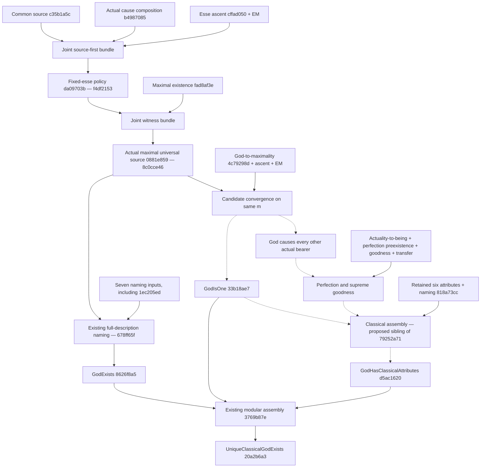

# Is modal necessity load-bearing for the root? (2026-11-23)

This is the first of four follow-up questions after #1887. All of the #1870 → #1884 → #1887 work (C2, power-grounded possibility, Pruss's argument, existence in essence) bears on one modal crux: whether a foundational, simple being's possible absence needs a ground. This note asks which routes to the root depend on modal necessity at all, and which depend on that crux in particular. It is a structural question about the graph and makes no claim about warrant.

## Method

The data is the frontier and corpus at `main` `fd78b77e6`. The method is a least fixpoint over verified arguments.

1. **Excluded statements**, in three variants:
   - (a) statements whose label, paraphrase or Lean declaration name mentions modal necessity or contingency (244 statements). This covers NECESSARY_2 and NECESSARY_6–12, `NecessaryAt`, `ContingentAt`, CONTINGENCY_1, accessible worlds, and Kripke frames and frame classes;
   - (b) (a) plus Aquinas's "cannot not-be" senses (264 statements): NECESSARY_1/3/4, `IsNecessary` and necessary per se;
   - (c) the Lean-level classification. Each statement's `lean_declaration` was resolved by namespace, and its `def`/`abbrev` body was unfolded up to two levels and searched for `NecessaryAt`, `ContingentAt`, `.access`, `Box`, `Diamond`, `□`, `◇`, `NecessaryBeing`, `IsNecessary` and `NecessaryExistence`. This finds 656 statements. Variant (a) misses 439 of them, and (a) and (b) together miss 423.
2. **Leaves** follow the leaf rule of `truth frontier --routes`. A statement is a leaf if it is established, stated or supported (whether or not proved), has no verified non-transcription argument, or sits in an ungrounded cycle. Other proved statements must be derived through a verified argument whose premises are all derivable. A stricter rule also expands proved statements that are stated or supported. It gives the same counts, provided statements closed by transcription can still be expanded through their transcription arguments. If only non-transcription arguments are allowed, every route fails, even with no modal exclusion: the stage-3 node `a04f711a` depends on the transcription closure of `5baad26f`. That dependence has nothing to do with modality. (`statement_depths` covers every statement, so it cannot serve as the leaf test.)
3. **The test.** Derivability is computed with excluded statements never allowed. A verified root argument is modal-free when all of its premises are derivable. This is a question about which verified derivations exist down to the frontier's own leaves. It is not a question about which statements may be assumed.

The first draft of this note used `statement_depths` as the leaf test. That made every statement a leaf, so the test checked only direct premises. The independent challenge caught this, rebuilt the analysis, and confirmed the corrected results below under all three variants and both leaf rules. Its scripts are in the coordinator's scratchpad and are not part of this repository.

## Result

**25 of the 28 verified root arguments have modal-free derivations, under every variant.** They cover all the prima-via, quarta-via, efficient-regress, identity-witness and q.11 routes, plus the designated route `3b0f4fa5`. With Lean-level exclusion, their witness trees contain no modal statement at all: 67 statements under the route leaf rule and 301 under the strict rule. No route is modal-free only because of a transcription.

**Three routes need modal necessity:**

| Route | Cost | Blocked at | Through |
|---|---|---|---|
| `1deb1d29` | 52 | `c71c068c` STMT-EVERY-CONTINGENT-GROUNDED-AT ("every actual contingent concretum has an actual ground"; Lean: `ContingentAt`, accessible worlds) | the necessary-root closure, which is the modal crux |
| `3357fa30` | 53 | `c71c068c` | the same |
| `8df2faad` (cheapest) | 16 | `bed94ec2` STMT-NECESSARY-ROOT-ON-INTENDED-READING (Lean: `Box`, `IsNecessary`) | the KT/KTB/S4/S5 frame-correspondence arguments for NECESSARY_2 |

- **The first two routes** have `c71c068c` as their only blocking premise. Every other premise has a modal-free derivation. Some other modal statements appear in their support graph, but only on alternative derivations of other premises.
- **The cheapest route** depends on modal necessity, but not on `c71c068c`. If only `c71c068c` is excluded, it still goes through via the KT reading (`03a8322c`). Its frontier leaves include the T schema `cb456382` and the KT reading `0aa36cd6`.

**What this means for the modal crux.** It is load-bearing for exactly two routes: the two necessary-root routes, through `c71c068c`. Modal necessity more broadly, which includes the frame-correspondence readings, is load-bearing for three. For the other 25 routes, no verified derivation needs modal necessity.

This is a claim about which derivations exist. It does not say that the modal crux has no effect on those 25 routes. One of `c71c068c`'s three verified arguments (`2162ca9d`, via participation) uses `cb1cdea9`, and `cb1cdea9`'s derivation rests on leaves shared with the 25 routes: `7067553d`, `d5a94eb1`, `f8ba2429`, `64498e7e`, `c6d6379b` and `f296a694`. A defeat of `c71c068c` would therefore put disjunctive pressure, by modus tollens, on that derivation's premises, which include those shared leaves. It removes no premise from the 25 routes. The dependence is shared, not critical.

## Crux inventory of the 25 modal-free routes (stages 1–2)

This table is taken from the frontier's own per-route leaves (`routes[].open_premise_statement_ids`), restricted to leaves whose stages include 1 or 2. The count is the number of the 25 routes that have the statement as an open leaf.

| Routes | Leaves |
|---|---|
| **all 25** | `d5a94eb1` whatever causes a quality is more such; `d9fad785` the maximum in a genus causes the perfection in all others; `f8ba2429` the cause of being causes every perfection; `64498e7e` a cause's perfections are in it formally or eminently; `7067553d` nothing is in act except insofar as it is; `00e962ae` good = actually having a perfection; `ca07cae9` every composite has a uniting cause; `818a73cc` the classical attribute bundle names GOD_4 (supported) |
| 19–22 | `4c79298d` GOD_4 is maximal in being (22); `6c27657f` grades have a maximum (21); `a9622441` grades are found in things (21); `09c6d5f0` no component is the first being (20); `1ec205ed` fuller nominal profile (20); `eaa4c679` maximal in being is first (20); `a4d3261a` act is SIMPLY_PRIOR_1 to POTENCY_1 (20); `101bdd62` maximally TRUE_3 is maximally a being (19) |
| 12–16 | immaterial → intellectual `180f5ad2`; intellect → will `090be689`; immutable → eternal `0659227c`; subsistent being → infinite `75a37a91`; composite iff matter–form or esse ≠ essence `d7741cdc`; First Way core `4a952b96`, `f296a694`, `4be9a4ac`, `1e47e6db` (16 each); created agents act as applied `777646a5` (14); act–potency non-contradiction `c6d6379b` (12); no infinite per se mover series `226c38f6` (12) |
| ≤ 9 | the five GOD_4 attribute leaves `29818edd` (intellect), `66aecdd7` (will), `5bec93b3` (eternal), `b0132989` (infinite), `fb3802a8` (immutable) (9 each); firstness `74eb9113`, the unique pure-act mover is GOD_4 `a594d8c4`, no infinite per se efficient series `97f5850f`, per se mover link `c2880fe0` (4 each); the q.11 uniqueness premises (3 each); `034eb68f`, `bc44e1cd`, `e39a4fce` (2 each); `89cbb0af` (Meditation V premise), `cdc7a58f`, `0881e859` (1 each) |

Some statements are not open leaves. The observation `fbc516c1` is established as self-evident, and the dilemma "first mover or none" `ca075552` is closed by transcription from closed premises. All 25 routes also share stage-3 historical premises, which the current owner focus leaves out.

**Open leaf in every route versus needed by every derivation.** The counts above say how many routes have a statement as an open leaf in the frontier's chosen expansion. A separate test excludes each statement, on top of the modal exclusion, and reruns the fixpoint. It finds that seven of the eight "all 25" premises each remove all 25 routes. The exception is `d9fad785` (the maximum in a genus causes all): four routes have other verified derivations that avoid it, so excluding it removes 21. For the other rows the removal counts match the table: `4c79298d` removes 22, `6c27657f` and `a9622441` remove 21 each, `4a952b96` removes 16 and `226c38f6` removes 12.

## Implication for the next research

Eight premises are open leaves of **every** modal-free route. Together they form the common core of the God-existence and attribute stages on those routes:
- three causal-perfection principles: causal superiority `d5a94eb1`, the maximum causes all `d9fad785`, and the cause of being causes every perfection `f8ba2429`;
- perfections pre-exist in the cause `64498e7e`;
- actuality only through being `7067553d`;
- goodness = actuality `00e962ae`;
- composition needs a cause `ca07cae9`;
- the naming premise `818a73cc`.

To test whether a crux has unacceptable consequences, these are the premises whose defeat would remove the modal-free routes. Seven of them would each remove all 25 routes at once. `d9fad785` would remove 21. The Fourth Way grade premises carry 19–22 routes, the First Way core and the attribute bridges about 12–16, and the modal crux (`c71c068c`) carries 2.

Reproduction uses `truth frontier --json` and `truth frontier --routes --json`, the corpus arguments and results, and the fixpoint above. No CLI command answers the query "which routes are free of a class of statements" yet. Adding one belongs to the tooling follow-up.


## Follow-up (2026-11-24): God-specific esse causation instead of genus causality

**Draft research handoff; not certified, not a revised frontier measurement.**
Owner-requested continuation of #1928, dispatched as #1936 and #1937. Inspected
main `62bb4ce3cddf21bb2ebcd41489085d9fa99d3098` and the then-open #1928
head `1aea6f30a4a67767f531071144b48c7031394b4a`. The #1902 measurements
above remain historical. No changes to registered propositions, proofs,
sources, meanings, attempts, or computed closure are proposed in this draft.
Attribution deferred: the following are analyst deductions from existing
formal readings, not new claims about source texts.

### 1. A direct God-uniqueness candidate

The three premises registered by #1928's `14cbab05` already exist on main:

- `18561596`: `MaximumHasNoDistinctEsseCause InAct MoreIn CausesIn esse`.
- `fad8af3e`: `SomeBeingMaximalInBeing InAct MoreIn esse`.
- `86d02b69`: `GodCausesBeingOfAllOthers IsGod CausesIn esse`.

Use the same Being, Respect, InAct, MoreIn, CausesIn, esse and IsGod. In the
exact definitions, `IsMaximalIn` is definitionally `IsMaximumIn`:
`InAct m esse ∧ ∀ y, ¬ MoreIn esse y m`. The causal converse quantifies
over every distinct carrier individual, not only actual bearers.

Given a maximal witness m, take arbitrary g satisfying IsGod. If g ≠ m,
the converse supplies CausesIn g m esse; exclusion contradicts this.
Hence g = m. In classical logic all God candidates coincide; the existing
`GodIsOne` (`33b18ae7`) follows. More strongly, **if a God exists**, every
maximum at esse equals that God, not merely every God being maximal. Without
the existence premise, the joint bundle permits zero Gods. It does not
establish that a maximum exists in every possible world, that every maximum
causes all beings, or that arbitrary maxima are unique unconditionally.

Source definitions:
[exclusion](../../TruthCore/Case/Catholicism/MaximalBeingCauseExclusion.lean),
[causal converse](../../TruthCore/Causality/GodMaximalCausal.lean),
[maximal existence](../../TruthCore/Causality/TermSenseForks3.lean),
[GodIsOne](../../TruthCore/Case/Catholicism/StageTwo.lean).
Existing stage-two uniqueness `bc0cff0b` uses `d9fad785`, `d5a94eb1`,
`4c79298d` and explicit excluded middle; the q.11 nature argument
`d602ba9e` already avoids genus causality via a different substantive bundle.
The new candidate is not the first genus-free uniqueness route.

A second variant better fits the stage-two assembly: given
`GodIsMaximalInBeing` (`4c79298d`), exclusion and the causal converse,
take two God candidates g and g'. For g' ≠ g, the converse makes g cause
g'; g' is maximal, so exclusion rejects that cause. This does not require
a separate maximal-existence premise. When the assembly already supplies
`d5a94eb1`, its causal comparison can replace exclusion using `8bbe817d`
or the direct contradiction with maximality. In the existing explicit
logic reading retain `ee4ab504` as needed for equality; the proposed
direct #1928-bundle proof may use the same classical background as #1928,
subject to the repository's logic-floor and unused-premise checks.

**Small-model diagnostic (not Lean checked).** Exhaustive Python evaluation
of the definitions for two individuals, one respect, all four Boolean
predicates/relations (IsGod and InAct: two bits each; MoreIn and CausesIn:
four bits each) tested all 4096 structures. 172 satisfied all three premises,
56 of these had at least one God, and zero falsified at-most-one-God.
Zero joint models had both a God and two maxima. Dropping exactly one of the
three premises admitted 60, 196 and 116 two-God structures respectively
(in exclusion, maximal-existence, causal-converse order). This checks the
finite encoding, not philosophical necessity or global minimality.

Reproduction (standalone Python; not a new repository tool):

```python
from itertools import product
D = range(2)
def bits(n):
    return list(product([False, True], repeat=n))
joint = nonvacuous = failures = multi_max = 0
omissions = [0, 0, 0]
for G, A, M, C in product(bits(2), bits(2), bits(4), bits(4)):
    maxima = [m for m in D if A[m] and not any(M[y*2+m] for y in D)]
    H = [
        all(not C[c*2+m] for m in maxima for c in D if c != m),
        bool(maxima),
        all(C[g*2+y] for g in D if G[g] for y in D if y != g),
    ]
    if all(H):
        joint += 1
        nonvacuous += any(G)
        failures += sum(G) > 1
        multi_max += any(G) and len(maxima) > 1
    for i in range(3):
        omissions[i] += (
            sum(G) > 1 and not H[i] and all(H[j] for j in range(3) if j != i)
        )
assert (joint, nonvacuous, failures, multi_max, omissions) == (
    172, 56, 0, 0, [60, 196, 116]
)
```

Concrete two-actual-bearer controls, with identity interpreted normally and
unlisted relation entries false: the positive model has God = {0},
MoreIn = CausesIn = {(0,1)}. For omission of exclusion, both are Gods,
MoreIn empty and CausesIn = {(0,1),(1,0)}. For omission of maximal
existence, both are Gods and MoreIn = CausesIn = {(0,1),(1,0)}.
For omission of causal converse, both are Gods and both relations empty.
These are structural surrogates: the omitted exclusion model need not
satisfy causal superiority; the omitted maximal-existence model permits
mutual comparison; the omitted causal-converse model has no causation.
Certify relevant controls in Lean and inspect stronger background models
before interpreting them as rival metaphysics.

### 2. Three substitutions in the same attribute assembly

Existing solutions explicitly use general genus causality at esse in just
three local calculations in the all-attributes assembly:
[GodIsOne](../../TruthCore/Results/Case/Catholicism/StageTwo/GodIsOne/Solution.lean),
[GodIsPerfect](../../TruthCore/Results/Case/Catholicism/StageTwo/GodIsPerfect/Solution.lean),
[GodIsSupremelyGood](../../TruthCore/Results/Case/Catholicism/StageTwo/GodIsSupremelyGood/Solution.lean),
and [ClassicalAttributesAll](../../TruthCore/Results/Case/Catholicism/StageTwo/ClassicalAttributesAll/Solution.lean).
The following are complete candidate premise bundles for those local
conclusions, not registered proof edges:

| Target | Candidate inputs | Removed from corresponding stage-two bundle |
|---|---|---|
| `33b18ae7` GodIsOne | `4c79298d`, `86d02b69`, `d5a94eb1`, `ee4ab504` | `d9fad785` |
| `2639f425` GodIsPerfect | `86d02b69`, `64498e7e`, `ee4ab504` | `4c79298d`, `d9fad785`, `7067553d` |
| `e0dae79f` GodIsSupremelyGood | `4c79298d`, `86d02b69`, `00e962ae`, `f8ba2429` | `d9fad785`, `7067553d` |

**Perfection.** The current theorem `GodIsPerfect.godIsPerfect` handles
x = g by equality. In the distinct case, replace
`hGenus esse g (hMaximal g hg) x hOther (hBeing x r hx)` with
`hCausal g x hg hOther`. The existing `hPreexist` transfers the
represented perfection of x to g. Maximality and actuality-only-through-esse
are not otherwise used by this proof. This conclusion is the existing
represented-perfection predicate, not a resolution of the formal/eminent
or pure-perfection interpretation problem.

**Supreme goodness.** The current theorem uses `hMaximal` to establish
actual esse of g; the existing `hGoodness` supplies goodness at esse.
For each distinct x in act at r, `hCausal g x hg hOther` supplies the
esse-cause argument to `hPerfections`. This avoids both genus causality
and `hBeing` in that calculation, not the substantive goodness or
perfection-causation premises. It is not a theorem of moral benevolence.

**Assembly.** In the existing `ClassicalAttributesAll.godHasClassicalAttributes`
body (argument `79252a71`, conclusion `d5ac1620`), `hGenus` is passed
only to hOne, hPerfect and hGood; `hBeing` is passed only to the latter two.
Replace those three calls by the new siblings (the first uses hMaximal
and hCauseMore already available). All other arguments and the exact
nine-predicate `hSuffice` remain unchanged. Thus the proposed sibling
replaces `d9fad785` by `86d02b69` and removes `7067553d` from this
particular assembly, while retaining every other premise in `79252a71`.
For the local-logic sibling `6c6549ae`, examine its separately registered
`12dc2662` and local equality decisions rather than treating statement IDs
as interchangeable. No existing Challenge is to be weakened.

The existing modular [classical God assembly](../../corpus/arguments/classical-god-assembly.json)
`3769b87e` consumes `8626f8a5` (GodExists), `33b18ae7` and `d5ac1620`
to obtain `20a2b6a3` on the same actual witness. This identifies a concrete
downstream destination for the proposed siblings. It does not supply
`8626f8a5`. The all-attributes proof itself is universal over IsGod; using
its conditional conclusions to infer the initial existence witness would
be circular or vacuous. Other root routes may inline genus causality in
constructing their stage-one witness.

### 3. The substitute is not simply a weaker axiom

In the encoded setting, `d9fad785` quantifies over every respect and
maximum, restricted to actual bearers of that respect. `86d02b69`
quantifies over God candidates at esse, covering all distinct carrier
individuals. Neither entails the other even with nonempty IsGod,
God-maximality and causal superiority.

Two small structural controls (two individuals 0,1; respects esse,r;
God = {0}; unlisted facts false):
- InAct at esse = {0}, InAct at r empty, MoreIn and CausesIn empty.
  Genus causality holds vacuously for distinct actual bearers, God is
  maximal, causal superiority holds, but the God-specific converse fails
  at the distinct carrier individual 1.
- InAct at both respects = {0,1}; MoreIn and CausesIn at esse = {(0,1)};
  at r both relations empty. The God-specific converse, God-maximality and
  causal superiority hold; genus causality fails at r, since both actual
  bearers are maximal there but no distinct causal edges hold.

These are finite definition evaluations, not checked Lean certificates.
The first model's nonactual carrier and the second model's unrestricted
respect are essential to the displayed failure. If the intended application
makes every carrier actual at esse, the first contrast is not admissible
under that added assumption. If the genus principle is restricted to esse
only, the second contrast no longer witnesses the same claim. Both
scope differences deserve explicit controls, not a philosophical verdict
from a smaller premise count.

### 4. Current assessment and next discriminating test

The God-specific premise is relevant positive conditional support because
it directly supplies the cause used by these proofs, without requiring
that every maximum of every genus cause the other members of that genus.
It is not yet shown to have stronger warrant: the converse has its own
naming and actual-carrier scope burden, and a plural-source rival can
deny that one God candidate is the cause of every distinct carrier.
The shared causal-superiority, causal adequacy and attribute-identity
commitments remain. No prior premise-warrant assessment is superseded.

#1936 owns uniqueness; #1937 owns perfection, goodness, assembly and
downstream exclusion audit. Before formalizing, run the existing
`truth related`, `dossier`, `novelty`, `semantics` and proof/binding gates
on the refreshed corpus. Use exact-bundle discovery once #1928 is available,
or construct the direct proofs with the current existing tools. Verify
positive/omission/independence controls, actual same-witness consumers and
reviewed senses, not only search success. Compare closure against the
#1902 procedure with modal necessity excluded, then remove `d9fad785`
alone and its definitionally matching sibling(s) together; isolate baseline,
#1928, uniqueness, attribute siblings and integrated assembly. Report actual
reachability of GodExists, UniqueClassicalGodExists and the root arguments
separately, including the first remaining upstream bottleneck and the
computed `truth frontier-diff`. A hypothetical graph edge is not a new
registered proof or an established premise.

**Blockers:** no prepared checkout, Lean, truth CLI, or independent semantic
challenger was available for this draft. The two-bearer diagnostic was
executed in Python; source definitions and the all-attributes proof were
read at the stated main revision. No formal result or premise change is
claimed. The independent final challenge and CI on the final proposed
formal content remain required. Retain these issues until the promised
integration or an exact unresolved blocker is documented.


### 5. Source-first integration: avoid even the strong God-specific converse

**2026-11-24 continuation, draft.** This section refines the candidate in
sections 1–4, not the historical #1902 analysis. Main remains
`62bb4ce3cddf21bb2ebcd41489085d9fa99d3098`. The existing
[maximum-definition fork research](maximum-definition-fork.md#current-existence-bundle-judgment-select-the-cause-before-identifying-the-maximum-2026-11-17)
already supplies a stronger starting point than assuming `86d02b69` directly.
No new canonical edge, checked theorem or premise assessment is claimed here.

#### Existing source and existence route

[MaximalFromEsseSource.maximalCauses](../../TruthCore/Results/Causality/MaximalFromEsseSource/Solution.lean),
argument `f4df2153` / result `82fb68e4`, derives fixed-esse
`da09703b` from `c35b1a5c` (one actual esse/essence-identity source with
actual cause paths to every other actual bearer), `b4987085` (actual
esse-cause composition), `cffad050` (distinct esse causes exceed effects
at esse), and `ee4ab504` (excluded middle).
It does not use the all-respects genus law `d9fad785`. The existing
`c98328f1` / `d8cb586a` consumes that fixed-esse conclusion plus eleven
other inputs to derive GodExists, retaining the same actual first root
through naming. The source-first result is not evidence for the truth of
common ancestry or composition.

A second exact existing path is particularly convenient for the proposed
attribute continuation:

1. `da09703b` and `fad8af3e` yield `0881e859` by `8c0cce46`:
   some m is maximal at esse and causes each distinct **actual** bearer
   at esse. Maximal existence is an extra input, not a consequence of
   fixed-esse maximal causality.
2. `0881e859` and seven additional inputs yield GodExists via
   [678ff65f](../../corpus/arguments/god-exists-from-maxime-ens-causing-all.json):
   `7067553d`, `d5a94eb1`, `ee4ab504`, `f8ba2429`,
   `09c6d5f0`, `eaa4c679`, `1ec205ed`.
   Sibling `5d2b7c6e` substitutes `cffad050` for unrestricted
   `d5a94eb1`. The supplied witness itself is named by the full-description
   premise after its uniqueness, universal causal scope, every-perfection
   causality and remoteness have been obtained.

These are registered conditional routes already present on main, not
discoveries of this draft or proofs of the premises. For the second route,
the following proposed argument can connect the very same witness to the
classical attributes without the strong carrier-wide God converse.

#### Candidate convergence theorem

Write A(x,r) for InAct, C(c,x,r) for CausesIn, and M(x) for the exact
weak IsMaximumIn at esse. Let U(m) mean CausesAllInGenus at esse:
for every x distinct from m, A(x,esse) implies C(m,x,esse).

Joint inputs:
- `0881e859`: some m satisfies M(m) and U(m).
- `cffad050`: for c distinct from x, C(c,x,esse) implies MoreIn esse c x.
- `4c79298d`: each IsGod g satisfies M(g).
- `ee4ab504`: equality case splits in the explicit classical reading.

Take the m supplied by the first premise. Suppose g is God and g ≠ m.
Then M(g) implies A(g,esse); U(m) gives C(m,g,esse); ascent implies
MoreIn esse m g, contrary to M(g). Thus g = m. In fact the first two
substantive premises alone imply every maximum equals m; the third
transports that identity to all God candidates. Alternatively use the
existing maximum-exclusion proposition `18561596` directly for the
contradiction instead of ascent, or use `d5a94eb1` restricted at esse.

Consequences in this same dictionary:
- GodIsOne (`33b18ae7)), with no God existence inferred from this universal
  conclusion alone.
- Every God candidate causes every distinct actual bearer at esse
  (`∀ g, IsGod g → CausesAllInGenus InAct CausesIn esse g`).
- If additionally the existing naming bundle for `678ff65f` holds,
  the supplied m is God, not an unrelated existential witness.

The second conclusion is a **candidate helper**, not an invented statement
ID or a proof of the stronger `86d02b69` (which quantifies over inactive
carrier individuals as well). It can be kept local to the consumer; register
a separate proposition only if reuse warrants it. This avoids replacing an
all-genus law by a God-specific axiom with unmotivated carrier-wide scope.

**Finite diagnostic, executed in Python.** Exhaust all 4096 structures with
two individuals and one respect. With M and U as above, test the three
substantive inputs, ordinary classical equality, and the conjunction of
at-most-one-God and actual-bearer God-causality:

```python
from itertools import product
D = range(2)
def bits(n):
    return list(product([False, True], repeat=n))
joint = nonempty = failures = strong_failures = 0
omission_failures = [0, 0, 0]
for G, A, M, C in product(bits(2), bits(2), bits(4), bits(4)):
    maxima = [m for m in D if A[m] and not any(M[y*2+m] for y in D)]
    def U(m):
        return all(C[m*2+x] for x in D if x != m and A[x])
    H = [
        any(U(m) for m in maxima),
        all(not C[c*2+x] or M[c*2+x] for c in D for x in D if c != x),
        all(not G[g] or g in maxima for g in D),
    ]
    conclusion = sum(G) <= 1 and all(U(g) for g in D if G[g])
    if all(H):
        joint += 1
        nonempty += any(G)
        failures += not conclusion
        strong_failures += any(
            G[g] and not C[g*2+x] for g in D for x in D if g != x
        )
    for i in range(3):
        omission_failures[i] += (
            not conclusion and not H[i] and all(H[j] for j in range(3) if j != i)
        )
assert (joint, nonempty, failures, omission_failures, strong_failures) == (
    128, 64, 0, [36, 20, 128], 32
)
```

All 128 joint models satisfy the candidate conclusion; 64 have at least
one God. The three omission counts refer to falsification of the **joint**
conclusion, not separately to the necessity of each input for each
conjunct. The strong carrier-wide converse fails in 32 joint models.
A nontrivial three-carrier illustration: 0 and 1 are actual at esse, 2 is
inactive; God = {0}, MoreIn and CausesIn at esse = {(0,1)}.
Then 0 is the sole maximum and universal actual source, but causes no
inactive carrier 2. If all carriers are assumed actual at esse, that
separator is unavailable. These are structural diagnostics only. Re-run
with intended carrier constraints, include the full naming premise in a
nonvacuous control, and certify relevant models in Lean.

#### Candidate attribute integration using actual-bearer scope

The existing all-attributes assembly `79252a71` can retain the same
18 other premises and replace **only** `d9fad785` with `0881e859`,
using convergence and the existing `d5a94eb1` at esse. Unlike the
strong-converse proposal, retain `7067553d` because actualities must be
related to esse to use U(m). No new God-specific causal premise is needed.

- Uniqueness: convergence.
- Perfection: if A(x,r), actuality-to-being gives A(x,esse); if x ≠ g,
  actual-bearer universality gives C(g,x,esse), and `64498e7e` yields
  A(g,r). If x = g, transport directly.
- Supreme goodness: M(g) gives A(g,esse); `00e962ae` yields goodness at
  esse. For each distinct actual x in r, use the same C(g,x,esse) and
  `f8ba2429` to cause its represented perfection. Existing restricted
  `b26c10a0` (UniversalCauseTransfersPerfections) is a further candidate
  replacement once actual-bearer universality is supplied; it is not an
  established warrant for the transfer.
- The other six attributes reuse the unchanged calls in
  [ClassicalAttributesAll](../../TruthCore/Results/Case/Catholicism/StageTwo/ClassicalAttributesAll/Solution.lean):
  simplicity, infinity, immutability, eternity, intellect and will.
  The same g is passed to `818a73cc`, yielding `d5ac1620`.

The final candidate bundle is precisely the existing `79252a71` bundle
minus `d9fad785` plus `0881e859`. It does not discharge `4c79298d`;
the forward naming premise does not imply its converse, and using God
maximality derived from the stronger `86d02b69` would reintroduce that
stronger obligation. Direct acceptance of `4c79298d` or its other
existing support options remains visible.



Solid arrows from complete bundles denote existing registered conditional
connections; dotted arrows denote proposed consequences/integration. The
six-attribute box abbreviates all the retained `79252a71` obligations;
the diagram is not an exhaustive formula. Every incoming edge to a joint
bundle is conjunctive. The final assembly is the existing structural
consumer, not a newly verified chain.

#### Specific root-route test and residual crux

The existing root argument [fa24c576](../../corpus/arguments/catholicism-from-maxime-ens-causing-all.json)
directly takes `0881e859`, the seven naming inputs from `678ff65f`,
`d5ac1620`, and the seven retained stage-3 premises. The proposed
assembly sibling would therefore give a **specific candidate complete
dependency route**, from fixed-esse source support through both stage-one
and stage-two inputs, avoiding direct use of `d9fad785` and `12dc2662`
at these local steps. This is a structural substitution check, not a
fresh verified fixpoint. It does not tell whether fa24c576 was among the
four historical surviving routes, whether all expanded premises admit
modal-free and genus-free derivations under the #1902 leaf rule, or how
many additional routes survive. Those require the existing frontier CLI
on the integrated corpus.

The first genuinely philosophical residual issue is source selection:
`c35b1a5c` already presupposes one common actual ancestor. A plurality of
underived sources could instead supply different disjoint causal orders;
local causal ascent and transitive chains do not establish a common source.
The De ente at-most-one-esse/essence route and its open shared-nature
premise `75b5b027` are the relevant next test, alongside the existing
`c35b1a5c` derivation, not an assumption that maximality by itself forces
causal universality. Compare several unreceived sources, one impersonal
universal source and a personal source under the same actual-production
and coverage criteria. A common source does not by itself establish
intellect, will, modal necessity or present sustaining causation. The
perfection and attribute bridges remain substantial.

**Next dispatch:** implement the source-first sibling within #1937,
prefer the already registered actual-bearer dictionary to a new strong
converse; check the exact `79252a71` and `fa24c576` consumers, and record
computed exclusions and frontier-diff after certification. #1936 remains
the separate #1928 uniqueness investigation. No independent challenge or
Lean/CLI run is available in this session; the 4096-model diagnostic was
executed and the section 1 diagnostic was rerun with matching counts.
No change to registered proof status, corpus records or philosophical
warrant is warranted by this draft.
